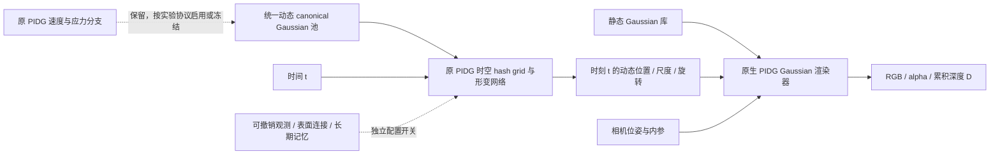
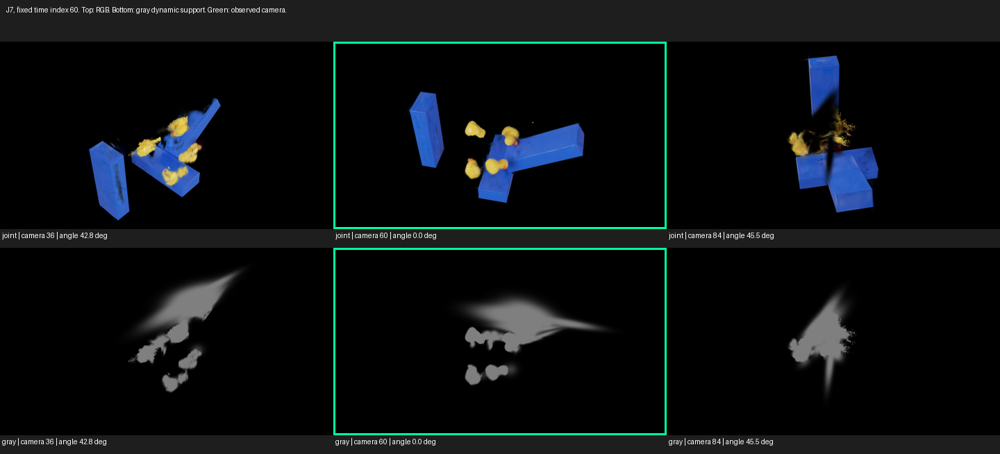

# PhysGauss

**基于 Physics-Informed Deformable Gaussian Splatting（PIDG）的动态场景重建研究。**

当前重点是 Rubber Duck 场景：在不预设动态物体数量的前提下，研究静态/动态联合重建、可撤销表面追踪、局部结构约束及长期观测记忆，尽可能减少拖影、碎裂和悬浮支撑，同时保留结构完整性。

本仓库保存源代码、实验协议、正负结果与审计记录。**目前尚未解决稳定的新视角完整重建，也没有验证真实材料参数或接触力恢复。** 实验执行完成与几何成功分别记录。

[当前实验总计划](experiments/staged_reconstruction_plan.md) · [重建改进计划](experiments/adaptive_reconstruction_plan.md) · [源码映射](PIDG_REPO_MAP.md) · [PIDG 复现说明](reproduction/README.md)

## 当前模型结构



- **静态分支**：独立 Gaussian 库；当前 J7 使用由 RGB/多视角几何发现和训练得到的 3,273 点静态库，未使用蓝色阈值。联合阶段冻结静态位置、尺度与旋转，仅更新 opacity 和球谐外观（SH）。
- **动态分支**：15,507 点统一 canonical Gaussian 池，加原 PIDG 时空形变场。点数是表示容量，不是鸭子数量；未知身份与遮挡保持不确定。
- **原生合成**：静态和变形后的动态 Gaussian 在同一渲染器中共同深度排序、alpha 合成。动态单独渲染只用于明确标注的诊断。
- **物理分支**：保留 PIDG 的速度/应力与相关接口；近期 J6/J7/J8 联合实验冻结物理参数、物理 Adam 和图缓存，属于 RGB 重建续训，不能称为新增物理训练。
- **来源限制**：当前静态发现已移除蓝色阈值，但动态父模型仍有历史颜色条件掩膜来源。整模型不能称为从零完全无标签重建。

新增研究模块默认关闭。`src/physgauss` 是早期独立参考架构；正式 PIDG 原生实验主要位于 `reproduction/`、`variants/` 和 `pidg_ext/`，两者的结果不能混用。

## 最近实验结果

以下 RGB 指标来自对应协议的 30 张验证图、原生宽度 1600；它们不是独立三维几何指标。

| 实验 | 做了什么 | 实测结果与结论 |
|---|---|---|
| [J6：I10 静动态联合](experiments/staged_reconstruction/RubberDuck_I10_joint/v1/assessment.md) | 匹配的静态冻结/静态 opacity 与 SH 联合，两臂各 2,000 步 | 联合 PSNR **31.9947 dB**，较对照 +0.5935 dB；动态碎裂与暗色拖尾仍存在 |
| [J7：无蓝色阈值静态库融合](experiments/staged_reconstruction/RubberDuck_colorfree_joint/v1/assessment.md) | 用 RGB/几何静态库替换旧库，匹配联合训练各 2,000 步 | 候选 PSNR **34.0451 dB**，对照 32.1062 dB；外观改善，未通过完整几何清理门槛 |
| [J8：J7＋长期观测记忆](experiments/staged_reconstruction/RubberDuck_J7_long_memory/v1/assessment.md) | 可保存、可暂停/撤销的观测记忆，匹配续训各 2,000 步 | 记忆组 **34.1731 dB**，对照 34.3005 dB；局部追踪改善，未稳定修复完整性，保留 J7 |
| [V0：相机×时间检查](experiments/staged_reconstruction/RubberDuck_view_time_audit/v1/assessment.md) | J7/J8 三模型、共 **1,446** 组只读交叉渲染；独立进程逐值复算 | 支持训练轨迹附近拟合较好的现象；灰色动态支撑仍有拖尾，不能只归因颜色或静态遮挡 |

### 固定时间、改变相机

下图来自 J7。所有格子使用同一时间；上排是 RGB，下排移除静态遮挡并把动态 Gaussian 统一渲染为灰色。绿色框是该时间的原训练相机，左右相机视线分别偏离约 42.8°/45.5°。



原相机 RGB 相对完整，但灰色支撑已经有大片拉长区域；换视角后表面明显碎裂。这支持轨迹相关拟合和几何欠约束，**没有同时间的新视角真值，因此不能证明过拟合是唯一原因或给出真实几何误差**。

训练派生划分有 120 张训练图、120 个精确时间和 120 个不同相机位姿，同时间多相机观测为 0。该 120/30/50 重建划分与官方基线的 150/50 划分不同，不能直接混合比较。Rubber Duck 是 PIDG 发布的物理基准场景，不应将目录中的 `real` 标签解释为本项目采集的真实相机数据。

更多完整记录：[S1–S6 汇总](experiments/staged_reconstruction/final_summary.md)、[J7/J8/V0 协议与审计](experiments/staged_reconstruction/)。失败候选、CUDA 恢复差异与未晋级结果均保留，没有只展示最优指标。

## 获取项目

```powershell
git clone -c core.autocrlf=false https://github.com/JiruiUk/PhysGauss-.git
Set-Location PhysGauss-
```

部分实验使用源码原始字节的 SHA256；避免自动换行转换，并遵循对应实验的 `.gitattributes` 和冻结清单。

仓库包含代码、配置、文本报告及部分小型可视化；以下内容不随 Git 上传：

- `data/` 数据集与派生资产；
- `runs/` 完整模型、Adam、RNG、相机状态等检查点；
- `models/` 预训练模型、第三方本地下载与 `third_party/`；
- `envs/`、缓存、编译产物和临时目录；
- 未纳入版本控制的批量 `output/` 渲染、视频与点云。

已有历史提交中的小型输出保留。实验报告内的本地绝对路径、完整视频/PLY 和检查点哈希是来源记录，不代表克隆后相应资产已存在。**J7/J8 等完整继承链需要取得协议指定且 SHA 匹配的本地资产，不能仅凭克隆直接恢复。**

## 运行与验证

### 1. 原生 PIDG 路径

已使用的环境为 Windows、Python 3.11.14、PyTorch 2.8.0+cu128、CUDA Toolkit 12.8、MSVC 14.44、RTX 5070 Ti。该组合是已验证记录，不是对所有硬件/平台的兼容承诺。

上游版本：

| 依赖 | 固定来源 |
|---|---|
| PIDG | [官方仓库](https://github.com/SCAILab-USTC/Physics-Informed-Deformable-Gaussian-Splatting)，`b77fd2107a50c875d7219bb4f82388d5e5ea1319` |
| 光流 rasterizer | [上游仓库](https://github.com/HaoqinHong/flow-based-diff-gaussian-rasterization)，`2146a1c0dc3558644af420f20c21a0ad07ffa67a` |
| PIDG 数据 | [Hugging Face](https://huggingface.co/datasets/HaoqinHong/Physics-Informed-Deformable-Gaussian-Splatting)，`46b23520acaaf5d58938fb19b50a3a62d12c55df` |

先将对应上游代码及子模块放到 `third_party/PIDG/`，准备 `envs/pidg-cu128/` 环境并安装 [固定依赖](reproduction/requirements-windows.txt)。数据下载/哈希校验入口为 [download_dataset.py](reproduction/scripts/download_dataset.py)，其 `--manifest` 输入需提供对应发布修订的文件清单。详细兼容修复和论文/公开代码差异见 [复现说明](reproduction/README.md)。

```powershell
# 在准备好上游源码和 Python/CUDA 环境后执行。
envs/pidg-cu128/python.exe reproduction/scripts/apply_compatibility.py --repo third_party/PIDG
./reproduction/scripts/build_extensions.ps1 -ProjectRoot (Get-Location).Path

# 数据位于 data/PIDG/，CUDA 扩展可用后，先跑独立 smoke。
./reproduction/scripts/run_reproduction.ps1 -Smoke -Tag localcheck

# Rubber Duck 官方公开代码基线；新 Tag 避免覆盖已有结果。
./reproduction/scripts/run_reproduction.ps1 -Scenes rubber_duck -Iterations 50000 -Tag baseline1
```

上游配置将 Rubber Duck 拼写为 `rubber_dack`；runner 已显式映射。上述基线使用官方 split，与后续重建派生 split 分开记录。平台脚本包含本机路径/编译器设置，新机器应核对路径；不要修改历史冻结源码后把结果当成原协议重放。

### 2. 默认关闭与只读诊断单测

安装原生研究依赖后，以下测试无需启动训练：

```powershell
$env:PYTHONPATH = "$PWD;$PWD/src"
envs/pidg-cu128/python.exe -m pytest tests/test_view_time_audit.py -q -p no:cacheprovider
envs/pidg-cu128/python.exe -m variants.staged_reconstruction.view_time_audit.worker
# 输出 V0_DISABLED，不加载模型或启动渲染。
```

完整 V0 渲染需要协议中的三个原模型及父链资产。启用前检查 `plan.md`、`protocol.json`、冻结 SHA、停止文件和锁；不要为了运行演示而重启已完成训练。

### 3. 早期 CPU 参考架构（独立工程 smoke）

这一路径验证 manifest、参考渲染器、训练/恢复与状态导出接口，**不是原生 PIDG 基准，也不生成上表结果**。

```powershell
./scripts/bootstrap.ps1 -PythonExecutable python -Cpu
./.venv/Scripts/python.exe -m physgauss --help
./scripts/run_smoke.ps1 -RunName local_reference_smoke
```

配置在 `configs/`，数据约定在 [docs/data_contract.md](docs/data_contract.md)。

## 目录导航

```text
reproduction/                    PIDG 来源、环境、兼容修复、基线训练/恢复脚本
variants/staged_reconstruction/   静态发现、统一动态池、追踪/结构/联合/记忆实验
variants/                        其他独立历史对照及其原生代码快照
pidg_ext/                        独立物理扩展算子
src/physgauss/                   早期 CPU/PyTorch 参考架构
experiments/                     协议、配置、评估、失败和独立审计记录
tests/                          算子、默认关闭、状态与原生路径测试
scripts/                        环境、实验与报告工具
docs/                           技术说明与 README 示意图
external/                       少量固定第三方源码/许可记录
```

实际函数映射以 [PIDG_REPO_MAP.md](PIDG_REPO_MAP.md) 为准。实验计划里的“下一步”不是默认自动队列；恢复暂停任务需要用户明确指示。

## 实验约定与当前限制

- 保留原 PIDG 路径，新增模块通过独立开关启用，不重写基线。
- 单候选协议先声明输入、损失和门槛，再测试、训练与评估；每个里程碑独立提交。
- 完整训练恢复包括模型、两个 Adam、参数绑定、RNG、相机采样及物理图；原生 CUDA 的长轨迹差异和用户接受的精确状态/固定梯度验收分别保留。
- RGB/PSNR、alpha、D/alpha、训练图像轨迹和合成独立 GT 分开报告。低 alpha 黑色表示缺失，不能当作零几何误差。
- 几何/身份不确定时保持未知；不根据暗色、RGB 残差或遮挡直接删点或判背景。
- 当前仍缺少经过独立验证的完整动态表面、跨遮挡持续身份、厚度及接触几何。单次图像指标提升不代表这些问题已解决。
- 本构、材料参数、多材料、未知力和可辨识性是 [AGENTS.md](AGENTS.md) 中的独立路线；不能把近期 RGB 实验写成已完成物理参数恢复，也不将固体本构用于烟/流体。

## 上游与许可

本项目以 [Physics-Informed Deformable Gaussian Splatting](https://github.com/SCAILab-USTC/Physics-Informed-Deformable-Gaussian-Splatting) 为基础；论文见 [AAAI](https://ojs.aaai.org/index.php/AAAI/article/view/42474)。3DGS/rasterizer、hash encoder 和其他第三方源码保留各自来源及许可/文件头；本仓库不改变它们的许可条件。当前未为项目新增统一开源许可证。
