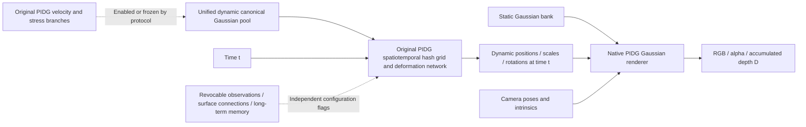

# PhysGauss

**Dynamic scene reconstruction research based on Physics-Informed Deformable Gaussian Splatting (PIDG).**

The current focus is the Rubber Duck scene: joint static/dynamic reconstruction, revocable surface tracking, local structural constraints, and long-term observation memory, without assuming the number of dynamic objects. The goal is to reduce trailing artifacts, fragmentation, and floating geometry while preserving structural completeness.

This repository contains source code, experimental protocols, positive and negative results, and audit records. **Consistently complete novel-view reconstruction remains unresolved, and recovery of real material parameters or contact forces has not been validated.** Experiment completion and geometric success are recorded separately.

[Staged experiment plan](experiments/staged_reconstruction_plan.md) · [Reconstruction improvement plan](experiments/adaptive_reconstruction_plan.md) · [Source code map](PIDG_REPO_MAP.md) · [PIDG reproduction guide](reproduction/README.md)

## Current model architecture



- **Static branch:** a separate Gaussian bank. J7 uses 3,273 static Gaussians discovered and trained using RGB and multiview geometry, without a blue color threshold. During joint training, static positions, scales, and rotations are frozen; only opacity and spherical harmonic appearance (SH) are updated.
- **Dynamic branch:** a unified pool of 15,507 canonical Gaussians with the original PIDG spatiotemporal deformation field. The point count is representation capacity, not the number of ducks. Identity and occlusion uncertainty remain unresolved where evidence is insufficient.
- **Native compositing:** static and deformed dynamic Gaussians share depth sorting and alpha compositing in the same renderer. Dynamic-only renders are explicitly labeled diagnostics.
- **Physics branches:** PIDG velocity/stress branches and their interfaces are retained. Recent J6/J7/J8 joint experiments freeze physics parameters, the physics Adam optimizer, and graph caches. These are RGB reconstruction continuations, not additional physics training.
- **Provenance limitation:** current static discovery no longer uses a blue threshold, but the dynamic parent model still inherits historical color-conditioned masks. The full model cannot be described as reconstruction trained from scratch without labels.

New research modules are disabled by default. `src/physgauss` is an early standalone reference architecture; native PIDG experiments primarily use `reproduction/`, `variants/`, and `pidg_ext/`. Results from these paths must be kept distinct.

## Recent experimental results

The RGB metrics below use the 30 validation images specified by each protocol, at native width 1600. They are not independent 3D geometry metrics.

| Experiment | Change | Measured result and conclusion |
|---|---|---|
| [J6: I10 static/dynamic joint training](experiments/staged_reconstruction/RubberDuck_I10_joint/v1/assessment.md) | Matched static-frozen and joint static-opacity/SH arms, 2,000 steps each | Joint PSNR **31.9947 dB**, +0.5935 dB over control; dynamic fragmentation and dark trails remain |
| [J7: static bank without a blue threshold](experiments/staged_reconstruction/RubberDuck_colorfree_joint/v1/assessment.md) | Replace the old bank with an RGB/geometry-derived static bank; matched joint training, 2,000 steps per arm | Candidate PSNR **34.0451 dB**, control 32.1062 dB; appearance improves, but the full geometric cleanup criteria are not met |
| [J8: J7 with long-term observation memory](experiments/staged_reconstruction/RubberDuck_J7_long_memory/v1/assessment.md) | Persistent observation memory that can be suspended or revoked; matched continuation, 2,000 steps per arm | Memory arm **34.1731 dB**, control 34.3005 dB; some local tracking improves, but completeness is not consistently repaired; retain J7 |
| [V0: camera-by-time audit](experiments/staged_reconstruction/RubberDuck_view_time_audit/v1/assessment.md) | **1,446** read-only cross-rendering pairs across three J7/J8 models, with exact independent-process replay | Supports better fitting near the training trajectory; gray dynamic geometry still has trails, so color or static occlusion alone cannot explain the artifacts |

### Fixed time, varying camera

The figure below is from J7. Every column uses the same time. The top row shows RGB; the bottom row removes static occlusion and renders all dynamic Gaussians in gray. The green box marks the original training camera for that time. The left and right camera viewing directions differ from it by approximately 42.8° and 45.5°.


RGB looks relatively complete from the original camera, but the gray geometry already contains broad elongated regions. Surfaces fragment visibly from other views. This supports trajectory-dependent fitting and insufficient geometric constraints. **There is no simultaneous novel-view ground truth, so this does not establish overfitting as the sole cause or quantify true geometric error.**

The derived reconstruction split contains 120 training images, 120 exact times, and 120 distinct camera poses, with no simultaneous multicamera observations. This 120/30/50 split differs from the official baseline's 150/50 split; their results must not be compared as if they used the same protocol. Rubber Duck is a physics benchmark scene released with PIDG. A directory labeled `real` does not mean that this project captured it with physical cameras.

Further records: [S1–S6 summary](experiments/staged_reconstruction/final_summary.md) and [J7/J8/V0 protocols and audits](experiments/staged_reconstruction/). Rejected candidates, CUDA recovery discrepancies, and results that were not promoted are retained alongside successful measurements.

## Getting the project

```powershell
git clone -c core.autocrlf=false https://github.com/JiruiUk/PhysGauss-.git
Set-Location PhysGauss-
```

Some experiments verify SHA256 hashes of raw source bytes. Avoid automatic line-ending conversion and follow the relevant `.gitattributes` and frozen file manifests.

The repository includes code, configurations, text reports, and selected small visualizations. The following local assets are excluded from Git:

- Datasets and derived assets in `data/`.
- Full model, Adam, RNG, and camera-state checkpoints in `runs/`.
- Pretrained weights in `models/` and local third-party downloads in `third_party/`.
- Environments in `envs/`, caches, build artifacts, and temporary directories.
- Untracked bulk renders, videos, and point clouds in `output/`.

Small outputs already tracked in historical commits are retained. Local absolute paths, full video/PLY references, and checkpoint hashes in reports are provenance records; they do not imply that those assets are included in a clone. **Restoring the full J7/J8 inheritance chains requires the local assets specified by their protocols, with matching SHA hashes. Cloning the repository alone is insufficient.**

## Running and validating

### 1. Native PIDG path

The recorded environment is Windows, Python 3.11.14, PyTorch 2.8.0+cu128, CUDA Toolkit 12.8, MSVC 14.44, and an RTX 5070 Ti. This is a tested configuration, not a guarantee of compatibility with every platform or GPU.

Pinned upstream revisions:

| Dependency | Source and revision |
|---|---|
| PIDG | [Official repository](https://github.com/SCAILab-USTC/Physics-Informed-Deformable-Gaussian-Splatting), `b77fd2107a50c875d7219bb4f82388d5e5ea1319` |
| Flow rasterizer | [Upstream repository](https://github.com/HaoqinHong/flow-based-diff-gaussian-rasterization), `2146a1c0dc3558644af420f20c21a0ad07ffa67a` |
| PIDG dataset | [Hugging Face](https://huggingface.co/datasets/HaoqinHong/Physics-Informed-Deformable-Gaussian-Splatting), `46b23520acaaf5d58938fb19b50a3a62d12c55df` |

Place the matching upstream code and submodules in `third_party/PIDG/`, prepare the `envs/pidg-cu128/` environment, and install the [pinned dependencies](reproduction/requirements-windows.txt). Use [download_dataset.py](reproduction/scripts/download_dataset.py) for dataset download and hash verification; its `--manifest` argument requires a file manifest for the corresponding dataset revision. See the [reproduction guide](reproduction/README.md) for compatibility patches and differences between the paper and public code.

```powershell
# Run after preparing the upstream source and Python/CUDA environment.
envs/pidg-cu128/python.exe reproduction/scripts/apply_compatibility.py --repo third_party/PIDG
./reproduction/scripts/build_extensions.ps1 -ProjectRoot (Get-Location).Path

# With data in data/PIDG/ and CUDA extensions available, run a separate smoke test first.
./reproduction/scripts/run_reproduction.ps1 -Smoke -Tag localcheck

# Rubber Duck baseline from the official public code; use a new tag to avoid overwriting results.
./reproduction/scripts/run_reproduction.ps1 -Scenes rubber_duck -Iterations 50000 -Tag baseline1
```

The upstream configuration spells Rubber Duck as `rubber_dack`; the runner maps this name explicitly. The baseline above uses the official split, recorded separately from later reconstruction splits. Platform scripts contain local paths and compiler settings that must be checked on a new machine. Editing frozen historical source changes the experiment and cannot be treated as replay of its original protocol.

### 2. Default-off and read-only diagnostic tests

After installing the native research dependencies, these checks do not start training:

```powershell
$env:PYTHONPATH = "$PWD;$PWD/src"
envs/pidg-cu128/python.exe -m pytest tests/test_view_time_audit.py -q -p no:cacheprovider
envs/pidg-cu128/python.exe -m variants.staged_reconstruction.view_time_audit.worker
# Prints V0_DISABLED without loading a model or starting rendering.
```

Full V0 rendering requires the three original models and parent-chain assets specified in the protocol. Before enabling it, check `plan.md`, `protocol.json`, frozen SHA hashes, stop files, and locks. Do not restart completed training just to run a demonstration.

### 3. Early CPU reference architecture

This separate engineering smoke test validates the manifest, reference renderer, training/recovery, and state-export interfaces. **It is not the native PIDG benchmark and does not produce the results in the table above.**

```powershell
./scripts/bootstrap.ps1 -PythonExecutable python -Cpu
./.venv/Scripts/python.exe -m physgauss --help
./scripts/run_smoke.ps1 -RunName local_reference_smoke
```

Configurations are in `configs/`; data conventions are in [docs/data_contract.md](docs/data_contract.md).

## Repository layout

```text
reproduction/                    PIDG provenance, environment, compatibility, baseline and recovery scripts
variants/staged_reconstruction/   Static discovery, unified dynamic pool, tracking, structure, joint and memory experiments
variants/                        Other historical controls and native code snapshots
pidg_ext/                        Independent physics extension operators
src/physgauss/                   Early CPU/PyTorch reference architecture
experiments/                     Protocols, configurations, evaluations, failures and independent audits
tests/                          Operator, default-off, state and native-path tests
scripts/                        Environment, experiment and report tools
docs/                           Technical documentation and README figures
external/                       Selected pinned third-party source and license records
```

See [PIDG_REPO_MAP.md](PIDG_REPO_MAP.md) for the function-level mapping. A plan's "next step" is not an automatic execution queue. Resuming a paused task requires an explicit user instruction.

## Experimental conventions and limitations

- Preserve the original PIDG path. Enable additions through independent flags rather than rewriting the baseline.
- Declare each candidate's inputs, losses, and acceptance criteria before testing, training, and evaluation. Commit milestones separately.
- Full training recovery includes the model, two Adam optimizers, parameter bindings, RNG, camera sampling, and physics graph. Native CUDA trajectory discrepancies and the user-approved exact-state/fixed-gradient acceptance checks are recorded separately.
- Report RGB/PSNR, alpha, D/alpha, training-image trajectories, and independent synthetic ground truth separately. Black pixels with low alpha represent missing observations, not zero geometric error.
- Keep uncertain geometry and identity unknown. Dark color, RGB residuals, or occlusion alone do not justify deleting points or classifying them as background.
- Independently validated complete dynamic surfaces, persistent identity through occlusion, thickness, and contact geometry remain unresolved. An image-metric gain does not establish that these problems are solved.
- Constitutive consistency, material parameters, multiple materials, unknown forces, and identifiability form a separate roadmap in [AGENTS.md](AGENTS.md). Recent RGB experiments do not demonstrate physical parameter recovery; solid constitutive models are not applied to smoke or fluids.

## Upstream work and licensing

This project builds on [Physics-Informed Deformable Gaussian Splatting](https://github.com/SCAILab-USTC/Physics-Informed-Deformable-Gaussian-Splatting); see the [AAAI paper](https://ojs.aaai.org/index.php/AAAI/article/view/42474). Third-party 3DGS/rasterizer, hash encoder, and other source files retain their own provenance, licenses, and file headers. This repository does not change their license terms. No new project-wide open-source license has been added.
