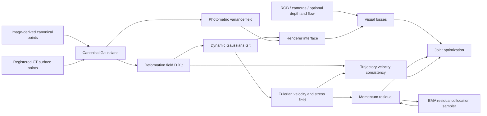

# 架构与计算约定



图中两种 canonical 输入是互斥的协议，不能在 public image-only 中混入 CT。CT 输入只有一个 canonical cloud，没有逐帧 CT label。

## 表示

Canonical Gaussian 为 `(μ, q, s, c, α)`；`q=(w,x,y,z)` 归一化，`s=exp(log_s)`，`c,α` 由 sigmoid 得到。形变 MLP 预测平移、log-scale 与小旋转增量，所有增量乘 `(t-t0)`，所以 `G(t0)=G0`。

该初版的时间锚定是工程选择，不声称等同于 PIDG/Grid4D。默认颜色不随时间变化，旋转／尺度形变没有由 deformation gradient 推导；后续可在该接口中加入更严格的连续介质变形。

## Eulerian / Lagrangian 一致性

形变输入为 canonical 材料坐标 `X`，输出当前位置 `x(X,t)`。材料场输入为当前位置 `x` 与秒单位时间 `t`，输出 `v(x,t)`、对称 `σ(x,t)`。

```text
r_traj = ∂x(X,t)/∂t - v(x(X,t),t)
r_momentum = ρ [∂v/∂t + (∇v)v - b] - div(σ)
div(σ)_i = Σ_j ∂σ_ij/∂x_j
```

动量 collocation 中位置 detach 后独立求空间偏导，避免误把材料轨迹导数当 Eulerian 偏导。轨迹项保留形变与材料场之间的梯度。`autograd.grad(sum(y),x)` 需要网络逐样本独立，因此这些场不能加入跨样本 attention 或 BatchNorm 而不改导数实现。

密度 `ρ` 与体加速度 `b` 是配置输入；参考合成场景采用无量纲长度、`ρ=1,b=0`。真实场景使用米、秒、kg/m³、m/s²，则应力单位为 Pa。归一化真实坐标由 loader 按 `meters_per_unit` 转到 SI。初始化点、相机平移、尺度和深度必须使用同一个长度单位。

## 损失与 adaptive 的含义

总目标包含 RGB L1、参考 D-SSIM、光度 Gaussian NLL、variance prior、可选 depth MAE、flow EPE，以及轨迹与动量平方残差。NLL 为 `0.5*(e²/variance + log variance)`，可以为负，不能用总 loss 正负判断训练是否健康。

variance 在 `[1e-4,0.1]`；prior 防止方差无约束地扩大。它仅调节 RGB likelihood，depth/flow 使用显式 valid masks。初版尚没有 epistemic uncertainty、几何可观测性估计或物理参数可信区间。

物理项先 warmup 后线性 ramp。collocation 权重由每个高斯的动量残差 EMA 决定，并混入固定比例的均匀采样。这里的 adaptive 是训练调度与残差采样；不是自动学习某种本构定律，也不是 uncertainty-conditioned physics weight。

## 模块扩展点

| 接口 | 当前实现 | 后续替换 |
| --- | --- | --- |
| `rendering.Renderer.render` | PyTorch 参考 splatter | tiled CUDA rasterizer，含 depth/flow/variance 且可微 |
| `models.fields.FourierMLP` | Fourier features + Tanh MLP | 4D decomposed hash encoding |
| `data.SceneDataset` | 统一 NPZ manifest | 各数据集预处理转换，不改 trainer |
| `MaterialField` | 独立 velocity/stress | 带本构关系的材料模型或参数场 |
| `engine.evaluate` | PSNR / 参考 SSIM / depth / flow | 官方 SSIM、LPIPS、3D motion 与参数 GT |

Renderer 输出 `rgb[H,W,3]`、`depth[H,W]`、`alpha[H,W]`、`variance[H,W]`、可选 `flow[H,W,2]`。flow 使用下一帧相机，包含相机运动；监督数据必须对应同一约定，不能直接混用 camera-compensated flow。

## 实验记录

checkpoint 保存模型、optimizer、步数、完整配置、采样 EMA 和 RNG。续训只允许修改设备、总步数、线程数和日志／存档频率。数据 manifest、frames 和 canonical 文件一起计算 SHA256，训练与评估／续训均要求一致。

训练 frame 只能来自 train mask。若 flow target 在 test 中，该 flow 不参与训练。测试评估只使用 test mask，记录协议与 `benchmark_compatible=false`。正式接入后也应保持 CT 与 image-only 表格独立。
