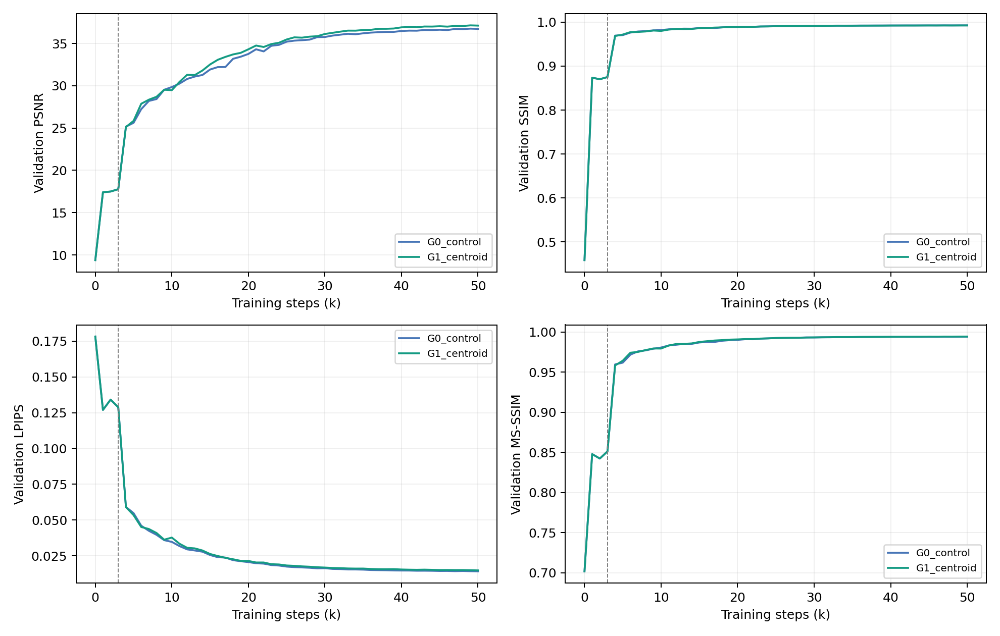
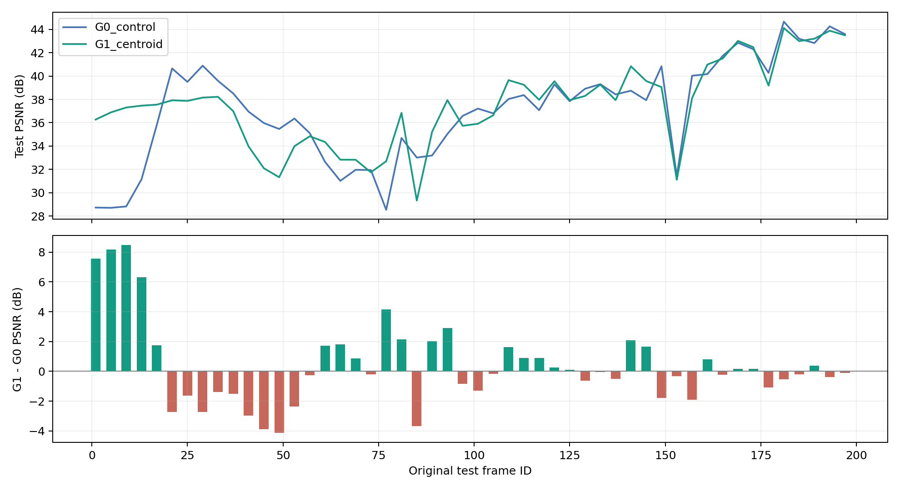
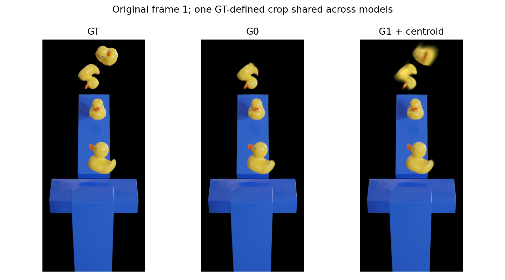
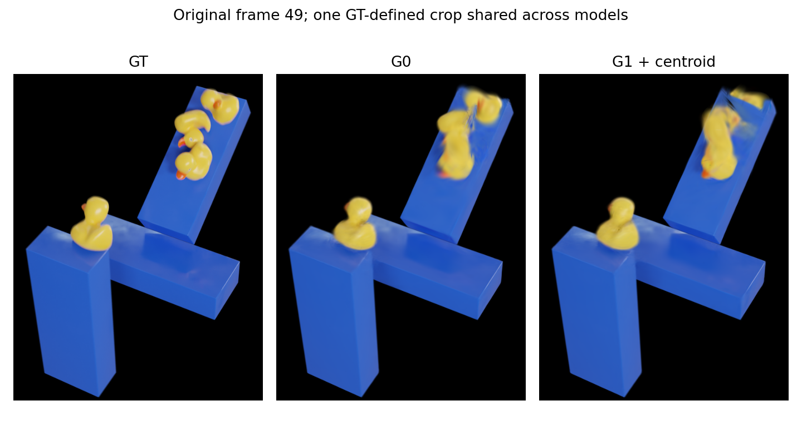
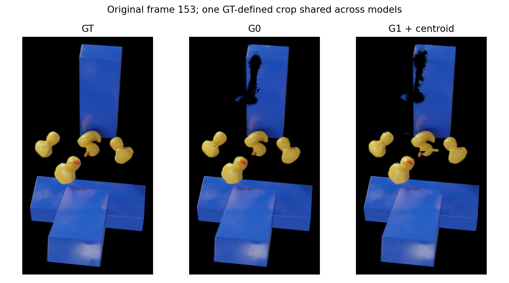

# G0 / G1: final50k assessment

Mixed: better mean PSNR/MS-SSIM and 2D alpha/centroid metrics; worse SSIM/LPIPS. PSNR improves on23/50 frames with a negative median; large early-frame gains drive the mean.

| Metric | G0 | G1 + centroid | G1-G0 | Better frames /50 |
|---|---:|---:|---:|---:|
| PSNR | 37.1393814 | 37.5278969 | +0.3885155 | 23 |
| SSIM | 0.9930494 | 0.9927845 | -0.0002649 | 18 |
| LPIPS | 0.0136453 | 0.0143062 | +0.0006609 | 19 |
| MS-SSIM | 0.9946546 | 0.9947529 | +0.0000983 | 22 |

| Diagnostic | G0 | G1 |
|---|---:|---:|
| Foreground PSNR | 28.0360983 | 28.6255687 |
| Mask IoU | 0.2679674 | 0.4283092 |
| Interior low coverage % | 0.1610412 | 0.0170162 |
| Normalized centroid distance | 0.0952306 | 0.0004957 |
| Centroid distance in pixels | 121.51997 | 0.55761 |
| Background false coverage % | 40.63463 | 15.99544 |

PSNR median paired delta: -0.13189 dB. Only23/50 frames improve.
Post hoc sensitivity: first3 frames (IDs1,5,9) average +8.0716 dB; remaining47 average -0.1019 dB. This does not replace the primary50-frame score.

The center target and coverage improve, but SSIM/LPIPS worsen. A global alpha moment constrains overall distribution, not local shape, color, object identity, depth or physical mass. Large early-frame gains drive mean PSNR; the method is not uniformly better.

## Visual observations

- Original frame1: G0 omits the upper duck; G1 recovers it but with blur.
- Original frame49: G1 has merged/blurred duck shapes and obstacle-boundary defects; this is the largest PSNR regression.
- Original frame153: dark obstacle defects remain in both; center agreement does not remove every visible gap.

Both runs share an identical complete3k state, confirmed by checkpoint SHA and identical pre-activation histories. Only centroid_weight differs. Single-scene/seed and post-branch CUDA divergence remain limitations. No test-based reselection is performed.

## Figures

## GT / G0 / G1 renders

Combined50-frame gallery: `F:\A_Edinburgh\PhysGauss\runs\pidg_centroid_tuning\render_comparisons\G0_G1_final50000\index.html`

Each source panel is preserved at1600x900 and pixel-verified; all GT pairs match.

