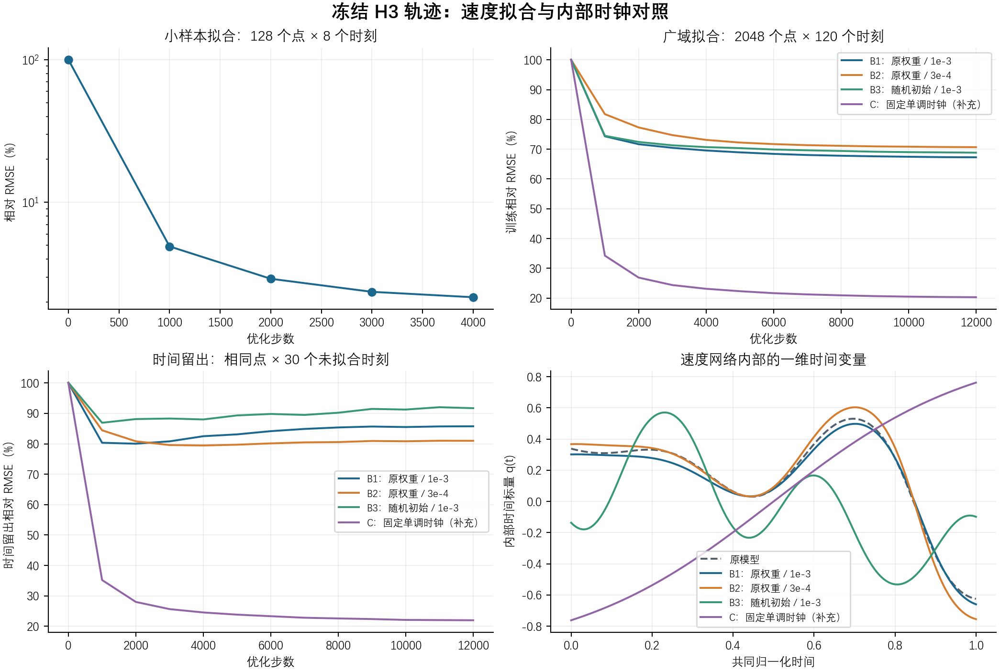

# 冻结 H3 轨迹：速度分支拟合实验

实验日期：2026-11-01。源模型为 H3 最终50k，单独训练诊断副本，不修改原模型或渲染器。

## 1. 实验干预与独立性

- 冻结 canonical 坐标、形变网络、hash grid；缓存完整渲染中心 R(q)X+b 的时间导数。h=0.001，端点用二阶单边差分。
- 唯一目标为速度预测与缓存导数的归一化 MSE；没有 CMR、外力、本构、材料、RGB 或应力目标。
- 使用原 PIDG VelocityNet 结构；训练共享特征、时间编码、ID embedding、速度头，冻结未使用的应力头参数。共享特征改变可能改变未使用的应力输出，所以该副本不能当作原应力模型直接部署。
- 训练点2048，独立留出点512；实际覆盖141个训练ID、33个留出ID，ID交集为0。先按ID家族分组，再采样opacity>=0.05的高斯，不是语义前景分割。
- 120个训练时间与30个验证时间不交叉。后者是本轮速度拟合未见的时刻，仍由同一H3重建模型产生目标，不是物理真值。没有读取final test图像或元数据。
- A为128点×8时刻、4000步全批量；B为2048点×120时刻、12000步、batch4096。所有模型按固定最终步数报告，不按验证择优挑选早期断点。
- C为发现时间碰撞之后追加的诊断对照：使用B1相同目标/初始非时钟权重/随机采样序列/优化预算，将内部时钟固定为tanh(2t-1)。没有增加空间平面、ID维度或MLP容量。它是事后对照，时钟取值范围与条件性也随之改变，不能把全部差值唯一归为折返。
- B3改变了初始化和随机种子，属于初始化敏感性检查，不能单独归因为初始化。C与B3部分并行运行，墙钟时间不是公平性能基准。
- 初次按高斯点划分时发现增点共享ID，存在97个ID重叠；已在A的3000步停止并完整归档。下表仅使用修正后ID整组留出的重新实验。

## 2. 固定预算结果

相对误差为整体RMS(v预测-轨迹导数)/RMS(轨迹导数)，不是逐粒子百分比平均。零速度参考为100%。运动点按训练导数固定阈值筛选；角度不包含近零预测速度。

| 实验 | 拟合集相对误差 %↓ | 时间留出 %↓ | ID留出/训练时刻 %↓ | ID+时间留出 %↓ | 时间留出夹角中位数 °↓ | 时间留出速度比中位数→1 |
|---|---:|---:|---:|---:|---:|---:|
| 原H3 | 100.04 | 100.04 | 100.11 | 100.11 | 95.52 | 0.05 |
| A：小样本 | 2.16 | 117.46 | 149.93 | 148.73 | 58.45 | 1.01 |
| B1：原权重 / 1e-3 | 67.29 | 85.77 | 100.70 | 106.17 | 28.32 | 0.77 |
| B2：原权重 / 3e-4 | 70.70 | 81.00 | 94.69 | 98.10 | 29.83 | 0.73 |
| B3：随机初始 / 1e-3 | 68.84 | 91.73 | 97.71 | 109.55 | 39.58 | 0.77 |
| C：固定单调时钟（补充） | 20.26 | 21.97 | 106.84 | 107.91 | 10.85 | 0.97 |

### 直接发现

小样本拟合误差降至2.16%，排除了明显断梯度或完全不可训练。广域采样目标上，B1误差为67.29%（训练）/85.77%（时间留出）；固定单调时钟C为20.26%/21.97%。
这些结果支持当前速度分支内部时间表示存在重要的混叠/条件性问题；这次没有修改数据集帧编号、共同时间轴或渲染输入时间。
C在ID+时间整组留出上仍为107.91%，空间/ID迁移尚未解决。训练家族与留出家族的空间分布和运动也可能不同，不能仅凭此把退步唯一归咎于embedding。
外力在本实验中没有加入，也没有参与任何目标，因此这次改善不能归因为补上外力。时间输入修正仍需后续受控接入联合训练，才能评价图像质量和物理残差。

A的时间/ID留出包含大量从未参与小样本拟合的训练点，不与B的广域训练含义混同；A用于检查小样本拟合能力。



## 3. 工程检查与目标可靠性

- 原诊断17项单元测试、时钟对照3项单元测试通过；两者各自100步真实CUDA smoke通过；未增加任何原训练路径钩子。
- 形变/grid参数哈希不变、梯度为空；同一导数重复查询逐位一致。所有源权重/冻结代码/配置哈希在拟合前后相同，缓存目标SHA256不变；留出ID embedding逐位不变。
- 速度分支首步梯度记录在各arm的result.json，所有受训参数组梯度有限。未使用的应力头参数逐位不变。
- 原H3五个诊断时刻的relative RMSE得到复现，单时刻差异均小于0.0002。
- h=0.00025相对h=0.001的导数变化：五个探针整体相对RMS 0.73% - 1.88%。这是数值步长敏感性，不是真实速度误差。
- h=0.0005相对h=0.001的导数变化：五个探针整体相对RMS 0.53% - 1.68%。这是数值步长敏感性，不是真实速度误差。
- h=0.002相对h=0.001的导数变化：五个探针整体相对RMS 0.86% - 1.91%。这是数值步长敏感性，不是真实速度误差。

### 时间碰撞机制检查（事后）

B1在t=0.03880253与t=0.79520000，内部时间值相差5.96e-08，256个固定点的预测速度差RMS仅1.38417e-05，而冻结轨迹导数差RMS为1.2849。这是几乎相同时间编码对应不同目标的直接例子。
若强制这两个时刻输出严格相同，仅这对查询的最佳相对RMSE下界为57.94%。它不是完整训练集误差的下界，也不是物理速度真值检验。
单调时钟C不应出现这种折返碰撞。完整数值见[时间碰撞检查](time_collision_checks.json)。

## 4. 可解释范围

- 小样本拟合成功只能排除严重断梯度/不可训练，不能证明网络可表示完整时间轨迹。
- 广域训练误差与时间留出误差必须一起解释；低训练误差而留出差，倾向于时空插值/过拟合或ID依赖问题；训练也高则还需区分优化、时间表示和容量，不能单次宣布容量不足。
- 时间编码先经Fourier，再投影压成一个标量，最终网络没有单独直接输入t。同一X和ID下，若该标量相同，速度预测相同。图中折返是时间混叠风险，仍需对照验证其具体贡献。
- 重建和图像渲染完全冻结，因此本实验不产生新的PSNR提升，也不能单独证明缺少外力导致原始误差。轨迹导数是模型内部teacher，不是物理速度GT。

## 5. 复现与原始产物

```powershell
. ./reproduction/scripts/enable_cuda.ps1 -ProjectRoot F:/A_Edinburgh/PhysGauss
envs/pidg-cu128/python.exe -m variants.frozen_velocity_probe.run --phase export
envs/pidg-cu128/python.exe -m variants.frozen_velocity_probe.run --phase smoke
envs/pidg-cu128/python.exe -m variants.frozen_velocity_probe.run --phase train
envs/pidg-cu128/python.exe -m variants.frozen_velocity_probe.time_control
envs/pidg-cu128/python.exe -m variants.frozen_velocity_probe.collisions
envs/pidg-cu128/python.exe -m variants.frozen_velocity_probe.report
```

默认输出拒绝覆盖已有拟合历史；重跑请复制配置并指定新的output_run。

- [预定协议](protocol.md)、[配置](config.json)、[结果JSON](results.json)、[时间细节](temporal_details.json)
- [追加时钟对照协议](clock_control_protocol.md)、[时钟对照结果](clock_control_result.json)、[时间碰撞检查](time_collision_checks.json)
- [单测日志](unit_tests.log)、[CUDA短测](smoke.log)、[拟合日志](train.log)
- 原始目标、哈希manifest和每组独立速度断点位于 `runs/pidg_frozen_velocity_probe/H3_final_20261101`。
