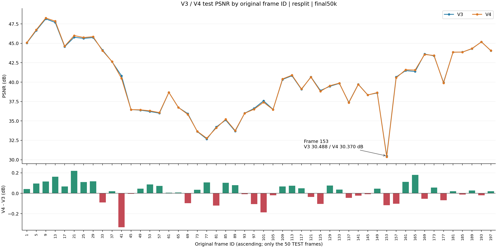

# V3 / V4：按原始帧编号排列的测试集 PSNR

使用重新划分后的120 train /30 validation /50 test，两模型均取最终50k checkpoint。
下表按原始帧号从小到大排列，仅包含测试帧；未计算的训练/验证帧不填充或插值。
PSNR 为全图指标，单位 dB。Δ = V4 − V3。渲染文件编号从0开始，与原始数据帧编号不同。

| 原始帧编号 | 渲染文件 | 归一化时间 | V3 PSNR | V4 PSNR | Δ PSNR |
|---:|---|---:|---:|---:|---:|
| 1 | 00000.png | 0.000000 | 45.0432 | 45.0843 | +0.0411 |
| 5 | 00001.png | 0.020101 | 46.6485 | 46.7443 | +0.0958 |
| 9 | 00002.png | 0.040201 | 48.1418 | 48.2567 | +0.1149 |
| 13 | 00003.png | 0.060302 | 47.6900 | 47.8516 | +0.1617 |
| 17 | 00004.png | 0.080402 | 44.5657 | 44.6318 | +0.0660 |
| 21 | 00005.png | 0.100503 | 45.7780 | 45.9976 | +0.2196 |
| 25 | 00006.png | 0.120603 | 45.6332 | 45.7433 | +0.1101 |
| 29 | 00007.png | 0.140704 | 45.7379 | 45.8550 | +0.1171 |
| 33 | 00008.png | 0.160804 | 44.1244 | 44.0346 | -0.0898 |
| 37 | 00009.png | 0.180905 | 42.6276 | 42.6471 | +0.0195 |
| 41 | 00010.png | 0.201005 | 40.8138 | 40.4808 | -0.3330 |
| 45 | 00011.png | 0.221106 | 36.4621 | 36.4567 | -0.0054 |
| 49 | 00012.png | 0.241206 | 36.3868 | 36.4317 | +0.0449 |
| 53 | 00013.png | 0.261307 | 36.2142 | 36.3013 | +0.0871 |
| 57 | 00014.png | 0.281407 | 36.0000 | 36.0722 | +0.0723 |
| 61 | 00015.png | 0.301508 | 38.6751 | 38.6808 | +0.0057 |
| 65 | 00016.png | 0.321608 | 36.7349 | 36.7418 | +0.0069 |
| 69 | 00017.png | 0.341709 | 35.9386 | 35.8412 | -0.0973 |
| 73 | 00018.png | 0.361809 | 33.6305 | 33.6650 | +0.0345 |
| 77 | 00019.png | 0.381910 | 32.6679 | 32.7735 | +0.1055 |
| 81 | 00020.png | 0.402010 | 34.2170 | 34.0968 | -0.1202 |
| 85 | 00021.png | 0.422111 | 35.1163 | 35.2193 | +0.1030 |
| 89 | 00022.png | 0.442211 | 33.6787 | 33.7587 | +0.0800 |
| 93 | 00023.png | 0.462312 | 35.9924 | 35.9841 | -0.0083 |
| 97 | 00024.png | 0.482412 | 36.6147 | 36.5080 | -0.1067 |
| 101 | 00025.png | 0.502513 | 37.5861 | 37.3989 | -0.1873 |
| 105 | 00026.png | 0.522613 | 36.4823 | 36.4617 | -0.0205 |
| 109 | 00027.png | 0.542714 | 40.3419 | 40.4092 | +0.0673 |
| 113 | 00028.png | 0.562814 | 40.8216 | 40.8960 | +0.0744 |
| 117 | 00029.png | 0.582915 | 39.0657 | 39.1151 | +0.0494 |
| 121 | 00030.png | 0.603015 | 40.6714 | 40.6360 | -0.0354 |
| 125 | 00031.png | 0.623116 | 38.9179 | 38.8143 | -0.1036 |
| 129 | 00032.png | 0.643216 | 39.4599 | 39.5361 | +0.0762 |
| 133 | 00033.png | 0.663317 | 39.8340 | 39.8698 | +0.0358 |
| 137 | 00034.png | 0.683417 | 37.3952 | 37.3508 | -0.0444 |
| 141 | 00035.png | 0.703518 | 39.7198 | 39.6967 | -0.0232 |
| 145 | 00036.png | 0.723618 | 38.3507 | 38.3411 | -0.0096 |
| 149 | 00037.png | 0.743719 | 38.6064 | 38.6505 | +0.0442 |
| 153 | 00038.png | 0.763819 | 30.4876 | 30.3704 | -0.1172 |
| 157 | 00039.png | 0.783920 | 40.6621 | 40.5603 | -0.1018 |
| 161 | 00040.png | 0.804020 | 41.4803 | 41.5924 | +0.1120 |
| 165 | 00041.png | 0.824121 | 41.3698 | 41.5501 | +0.1803 |
| 169 | 00042.png | 0.844221 | 43.6138 | 43.5597 | -0.0541 |
| 173 | 00043.png | 0.864322 | 43.3773 | 43.4330 | +0.0556 |
| 177 | 00044.png | 0.884422 | 39.9584 | 39.8897 | -0.0686 |
| 181 | 00045.png | 0.904523 | 43.8451 | 43.8657 | +0.0206 |
| 185 | 00046.png | 0.924623 | 43.8720 | 43.8602 | -0.0118 |
| 189 | 00047.png | 0.944724 | 44.3007 | 44.3278 | +0.0271 |
| 193 | 00048.png | 0.964824 | 45.1900 | 45.1706 | -0.0194 |
| 197 | 00049.png | 0.984925 | 44.0421 | 44.0616 | +0.0195 |

[下载逐帧 CSV](per_frame.csv) · [分布统计](summary.md)
