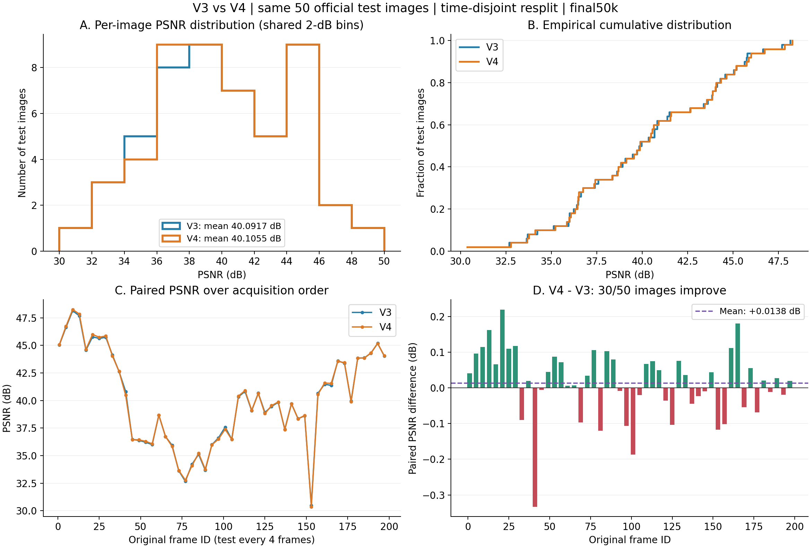

# V3 / V4 fixed-test PSNR distribution

Rubber Duck; time-disjoint120train/30val/50test; final50k snapshot; full-image PNG PSNR

V3: shared frame clock, V3 RGB objective, iso off. V4: V3 plus velocity/trajectory consistency.
Final50k is used for both. Validation-selected PSNR best also equals50k. No new training or test-based selection is performed.

| Statistic (dB) | V3 | V4 |
|---|---:|---:|
| Mean | 40.0917 | 40.1055 |
| Median | 39.8962 | 39.8798 |
| Std (population) | 4.2104 | 4.2408 |
| Minimum | 30.4876 | 30.3704 |
| 10th percentile | 35.0264 | 35.1071 |
| 25th percentile | 36.5154 | 36.4733 |
| 75th percentile | 43.8653 | 43.8643 |
| 90th percentile | 45.6437 | 45.7545 |
| Maximum | 48.1418 | 48.2567 |

Paired V4 minus V3: mean +0.013808 dB; median +0.023825 dB; V4 improves 30/50 and declines on 20/50.
Per-frame difference range: -0.332962 to +0.219582 dB.
Distributions nearly coincide. V4 shows a small PSNR shift, not a substantial across-frame gain.
Frames are temporally correlated; this single-scene, single-seed distribution does not establish repeated-run statistical significance.
These are full-image PSNR values, including background, not foreground-only scores.
Historical test exposure remains disclosed; the current separation does not undo it.

[Per-frame CSV](per_frame.csv) | [Full statistics](summary.json) | [Vector figure](psnr_distribution.svg)
