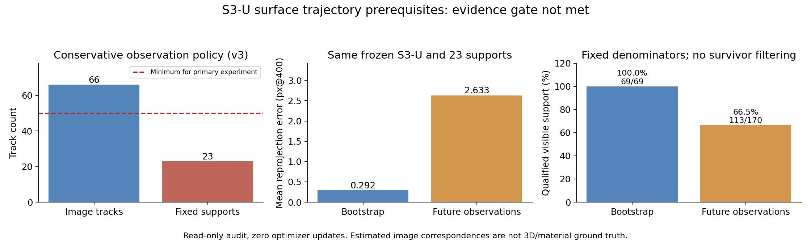

# S3-U 表面轨迹研究执行记录：R0/R1

日期：2026-11-03。研究预案已经执行到观测、固定支持绑定和准入检查；**当前证据门槛未过，未进入 R2 训练集成或 T0/T1 正式训练。新增优化器更新为 0。**

## 1. 主要发现

原始双向光流可以产生数值自洽的短轨迹，但图像复核发现不少轨迹位于白色高光附近。高光会随视角变化，尚不足以作为固定材料点依据。进一步排除检测到的高光邻域后，候选仍有 66 条，其中只有 23 条能在前三个观测建立合格的固定 Gaussian 支持，去重后只有 12 组。

这不是“轨迹监督训练失败”的结果：本次没有训练新模型。它说明现有图像跟踪与 S3-U 局部表面支持还不足以开展预案中的匹配训练。

## 2. 实际执行过程与数量

| 观测版本 | 方法与变化 | 合格图像轨迹 | 固定支持绑定 | 判断 |
|---|---|---:|---:|---|
| v1 | 较稀疏源时刻，只检查最长有效片段 | 22 | 未开展 | 低于最低 50 条，保留失败版本 |
| v2 | 增加源时刻，保留满足原质量阈值的 8–16 观测前缀 | 183 | 71 | 数量上可分 42 条监督 / 29 条留出，但复核暴露高光风险，未准入 |
| v3 | 黄色/橙色外观包络补小孔，排除检测到的亮白高光邻域 | 66 | 23 | 支持数量、时间覆盖和独立分组不足 |

v2/v3 的质量门槛均保留：至少 8 次观测，单步前后向误差及全片段反向闭环均不超过 0.75 px@400，局部 NCC 不低于 0.6，灰度 patch 标准差不低于 2。v3 改变了外观候选策略，**不能将数量变化解释为训练消融或对应准确率提升**。高光排除是像素启发式，不保证所有高光已经消除。

## 3. 预设准入条件与实际差距

| 条件 | 预案要求 | v3 实际 |
|---|---:|---:|
| 固定支持轨迹总数 | 至少 50 | 23 |
| 早 / 中 / 晚各段 | 每段至少 10 | 12 / 3 / 8 |
| 监督轨迹 | 至少 30 | 尚不能形成合格划分 |
| 留出轨迹 | 至少 20 | 尚不能形成合格划分 |
| 不与监督泄漏的留出组 | 至少 20 组 | 总共只有 12 组 |
| 稳定表面特征的局部图像依据 | 实际复核通过 | 仍有弱纹理、高光和局部漂移风险 |

绑定拒绝共 43 条：20 条在冻结投影容差内无法拟合 bootstrap，20 条存在相近的多种深度解释，3 条缺少三次观测共同的可见局部支持。没有根据后续误差挑选更容易的轨迹，也没有改动门槛以凑足训练数量。

## 4. 这 23 个固定支持能否延续到后续时刻

只读恢复同一个 S3-U final6k，将前三次观测确定的行号和非负权重固定，检查其后续可见观测：

| 指标 | Bootstrap（前三次） | 后续观测 |
|---|---:|---:|
| 观测数 | 69 | 170 |
| 有效投影数 | 69 | 170 |
| 平均投影误差 / px@400 | 0.291983 | 2.632924 |
| 中位投影误差 / px@400 | 0.213784 | 1.778250 |
| P90 投影误差 / px@400 | 0.726423 | 5.477183 |
| 仍满足可见支持门槛 | 69/69 | 113/170 |

后续有 57 次观测不再满足固定点群的局部足迹、前景纯度或质量门槛。分母固定，没有将失去支持的观测剔除。这个差距说明短时绑定不能直接外推为持续表面对应；图像轨迹偏差、真实可见性变化和模型形变/深度误差仍可能共同存在，不能唯一归因于 kernel 运动错误。

## 5. 图像复核范围

- v2：实际查看早/中/晚三张原生图像裁剪接触表，共 24 条轨迹、每条 8 个展示观测。不是全部 183 条逐帧审核。
- v3：实际查看三张接触表，共 19 条已绑定轨迹、每条 8 个展示观测；中段仅有 3 条绑定。不是全部候选的人工材料点标注。
- 可见部分眼睛、喙部附近特征，但多数候选仍来自弱纹理身体/颈部及反光附近。没有独立人工标注精度、持久顶点 ID 或遮挡后身份真值。
- 图像生成与实际查看分别记录。复核者为本助手的图像检查，不冒称用户或独立人工标注者完成了审核。

[v2 全部候选图像页](../../../output/staged_reconstruction/surface_trajectory/observations/index.html) · [v3 全部候选图像页](../../../output/staged_reconstruction/surface_trajectory/landmark_v3/index.html)

可直接复查的接触表：[v2 早段](../../../output/staged_reconstruction/surface_trajectory/observations/review_band_0.png)、[中段](../../../output/staged_reconstruction/surface_trajectory/observations/review_band_1.png)、[晚段](../../../output/staged_reconstruction/surface_trajectory/observations/review_band_2.png)；[v3 早段](../../../output/staged_reconstruction/surface_trajectory/landmark_v3/review_band_0.png)、[中段](../../../output/staged_reconstruction/surface_trajectory/landmark_v3/review_band_1.png)、[晚段](../../../output/staged_reconstruction/surface_trajectory/landmark_v3/review_band_2.png)。完整逐轨迹图像页和大型贡献缓存保留为本地可重建产物，接触表与汇总图随结果保存。

## 6. 验证与状态保护

40 项新旧相关测试通过，覆盖图像跟踪、短前缀、亮白邻域排除、三维加权后投影、多深度歧义拒绝、分组隔离、准入门槛，以及现有 S3-U/相机/轨迹契约。新入口默认关闭时，在没有输入数据的工作目录中退出，不初始化 CUDA 渲染器。

独立验证使用另一套显式双线性插值检查全部 271 条图像轨迹的 2760 段运动、前后向与反向闭环、局部外观阈值；最大坐标重放差为 1.526e-5 px。两套绑定的所有固定权重、接纳/拒绝和分组划分均重算一致。

真实 GPU 前向编码渲染检查未使用前 20 层截断元数据；最大贡献守恒相对误差约 1.21e-7。各只读 GPU 检查验证模型张量不变、没有参数梯度，父检查点 SHA 保持不变。独立核验了 378 个冻结源码/输入文件、120 张训练图像和 119 对原始双向流。未向对应提取器读取 val/test RGB。

已执行的是无优化器的前向诊断 smoke，**不是神经训练 smoke**。R2 的梯度/优化器 smoke、40→80 完整训练恢复、新 loss 集成和 T0/T1 均未开展，因为 R1 准入失败。现有 PIDG 训练代码和历史结果未被本分支改写。

初次 GPU 启动因进程 PATH 中没有 Ninja 退出，随后使用仓库现有 `enable_cuda.ps1` 解决；没有新装包或修改原渲染器。失败记录保留在 `revisions.json`。

## 7. 下一步决策

优先补充可以核验的表面对应：在较高分辨率中对眼缘、喙部等外观结构进行可见区间点跟踪，配合少量独立核验与定位误差评估，再按同样的时间覆盖、固定支持和去重门槛审查。不能仅通过更多弱纹理种子提高计数。

如果图像对应可信但仍无法建立足够固定支持，应单独审计 S3-U 的深度与表面表示。原数据目录中的 `.flo` 和 `depth_distill` 尚没有在本研究中被证明是材料点/动态几何真值，不能直接替代。额外同步视角、深度或合成器持久顶点数据优先用于独立评价；若引入新的训练监督，要另列数据条件和匹配对照。

现有结果不支持自动增加轨迹权重，也不能据此判断本构或未知外力能够修复问题。原计划的 T0/T1 仍是后续实验，待证据准入和 R2 预检通过后执行。

## 8. 文件索引

- [研究预案](../S3U_SURFACE_TRAJECTORY_RESEARCH_PLAN_20261103.md)
- [准入判断](admission.json)、[独立核验](verification.json)、[测试日志](tests.log)
- [版本变化与首次启动失败](revisions.json)
- [v2 轨迹](observation_v2/image_tracks.json)、[v2 绑定](bindings.json)、[v2 分组](split_manifest.json)、[v2 实际图像复核](visual_review_v2.json)
- [v3 轨迹](observation_v3/image_tracks.json)、[v3 绑定](landmark_v3/bindings.json)、[v3 分组](landmark_v3/split_manifest.json)、[v3 实际图像复核](landmark_v3/visual_review.json)
- [逐观测后续支持与投影误差](landmark_v3/future_support.json)
- [模块与复现入口](../../../variants/staged_reconstruction/surface_trajectory/README.md)

父状态：`runs/pidg_staged_reconstruction/S3_union/physics/formal/checkpoint.pt`；SHA256：`8c767b7835eee936e49989369d7bc0277d7567d3aedaa7385c06654284b68ad0`。
