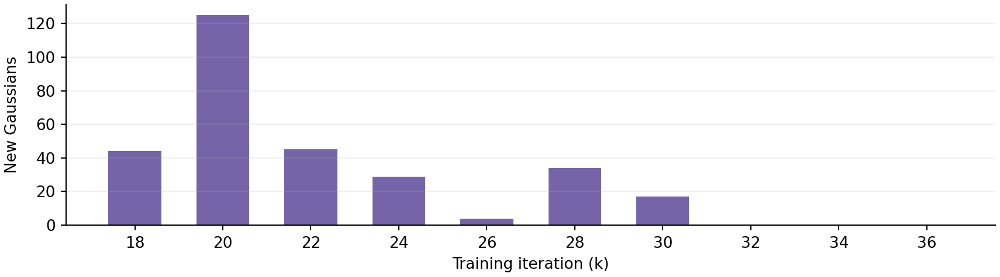
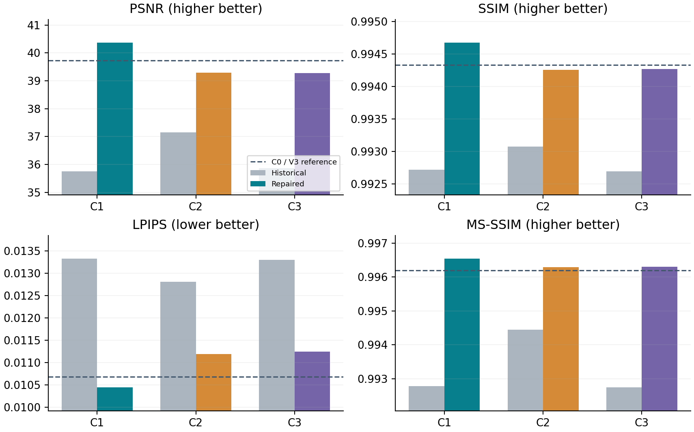
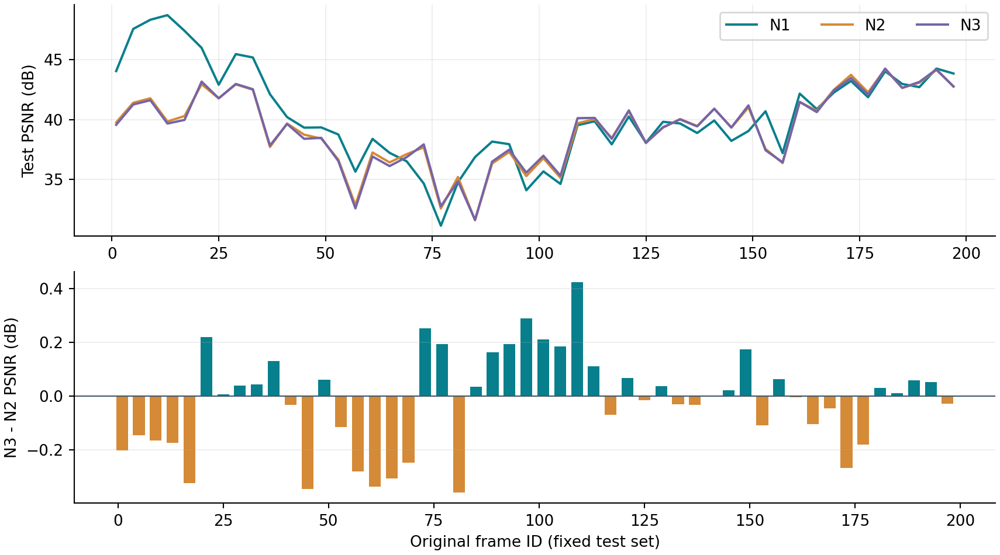
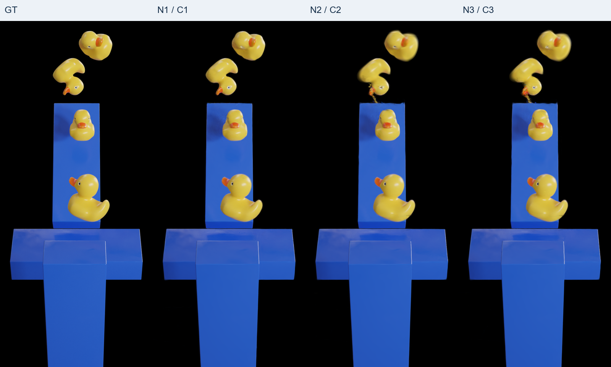
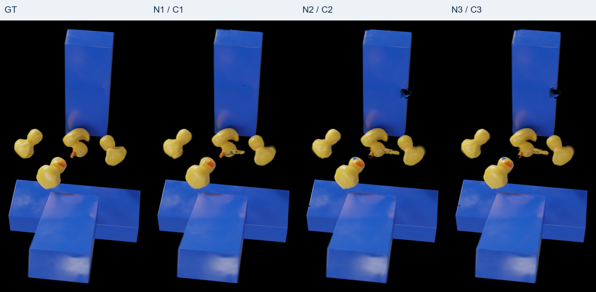
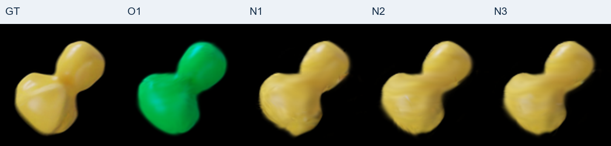
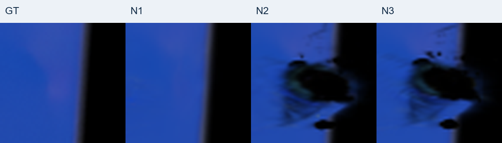

# PIDG C1-C3 修正与模块对比报告

## C1-C3 修正与模块对比报告

Rubber Duck | 最终50k模型 | 固定50张官方测试图 | 中文报告

Rubber Duck | 最终50k模型 | 固定50张官方测试图 | 中文报告

核心结论：新C1的四项图像指标最好；弱局部仿射约束降低了内部低覆盖率，但未提高本轮整体画质；新C3的定向增密没有显示明确的整体指标收益。

### 最终测试结果

| 模型 | PSNR↑ | SSIM↑ | LPIPS↓ | MS-SSIM↑ |

| --- | --- | --- | --- | --- |

| 新C1 | 40.3721 | 0.994676 | 0.010438 | 0.996546 |

| 新C2 | 39.2914 | 0.994259 | 0.011191 | 0.996293 |

| 新C3 | 39.2738 | 0.994271 | 0.011240 | 0.996301 |

相对对应旧版本，新C1/C2/C3的PSNR分别提高4.626、2.140、3.410 dB，四项图像指标均改善。新C1也超过C0/V3参考：PSNR +0.648 dB；这不是与原始PIDG官方全训练集基线的等价比较。

### 这轮改变了什么

共同修正：平滑正值SH颜色、保持初始RGB的逆初始化、延后且减弱mask监督、加入前景均衡RGB损失。新C2增加更弱且更局部的仿射一致性；新C3再增加颜色一致性筛选与新颜色初始化的覆盖增密。

三组均从新的随机初始化训练，总计各50k；模型主体仍为V3的W256_D0。未加入iso、速度-轨迹导数一致性或中心约束，也未新增颜色MLP。

本报告的主比较统一使用final50000，而非根据测试分数挑选快照。旧版到新版同时改变了多项设置，因此只能说明“修正组合有效”，不能把提升全部归因于某一个修正。

所有150张独立render、150张GT/render二联图和50张GT+C1+C2+C3四联图已生成。最后一页给出绝对保存地址。

## 实验结构与公平比较

120 train / 30 validation / 50 test；时间戳互不重叠，但仍属于交错时刻插值

120 train / 30 validation / 50 test；时间戳互不重叠，但仍属于交错时刻插值

| 设置 | 旧C1/C2/C3 | 本轮修正版 |

| --- | --- | --- |

| 主体与图像目标 | V3 W256_D0；L1、SSIM、LPIPS | 保留相同主体和V3图像目标 |

| mask | 权重0.1，从第1步启用 | 0.03；3k后启用，2k线性ramp |

| 颜色与前景RGB | SH+0.5后硬截断；无额外前景L1 | Softplus(beta=5)；前景L1权重0.1 |

| 局部仿射（C2/C3） | 权重1e-4；半径0.1 | 权重5e-5；半径0.05 |

| 覆盖克隆（C3） | 每轮最多512；继承全部SH | 最多256；颜色筛选；新DC、高阶SH清零 |

### 从零训练与共享状态

新的随机step0 → 共同训练至3k → 新C1继续至50k
共同3k → 开启弱仿射训练至15k → 新C2继续至50k
同一个完整15k状态 → 新C3继续至50k，并在18k-36k执行覆盖增密

3k和15k分支复制完整参数、优化器、随机状态、训练相机栈及验证历史。C2/C3的15k完整断点SHA一致，配置仅coverage_density不同；修正了旧实验在首次定向增密之前已出现分歧的混杂。CUDA分支后的非确定性仍然存在。

时间统一为t=(原始帧ID-1)/199；渲染与物理分支沿用V3的共同时间尺度。常规投影梯度增密保留并于15k前结束。仅120训练帧的RGB/alpha进入损失和颜色统计；30验证帧选择快照，三组选择锁定后才导出50测试帧。

图中N1/N2/N3表示新C1/C2/C3，O1表示旧C1。C0/V3不是未经修改的原始PIDG：它含LPIPS训练项及此前统一时间的设置。测试集具有历史调参暴露，本次划分不能把它重新变成完全未接触的新测试集。

## 修正一：恢复负颜色通道的梯度

作用于SH颜色参数化，不增加一个新的RGB预测网络

作用于SH颜色参数化，不增加一个新的RGB预测网络

### 旧路径与问题

q_i(d) = SH_i(d) + 0.5；旧颜色 c_i = max(q_i, 0)
当q_i < 0时，该通道沿颜色路径的局部导数为0。
新颜色 c_i = log(1 + exp(5 q_i)) / 5；dc_i/dq_i = sigmoid(5 q_i)。

旧模型的训练帧诊断在每组预定的9帧中发现负的原始SH颜色，前景贡献候选的负红通道比例约为旧C1 5.82%、旧C2 5.44%、旧C3 5.61%。候选ID不是精确的像素合成权重，不能由此断定每个黑斑或偏绿像素的唯一成因。

### 具体实现

用形变后中心到相机的方向d=normalize(x_i(t)-camera_center)计算SH，与原CUDA路径一致，再把平滑颜色送入既有光栅器。没有修改CUDA。关闭positive_color后回到原路径，RGB与alpha通过了逐像素一致性检查。

初始颜色c0保持不变：q0 = c0 + log(1-exp(-5 c0))/5
DC_new = (q0 - 0.5) / 0.2820947918
初始高阶SH为0；原本精确为0的RGB使用1e-4下限。

逆初始化只在新随机step0执行，断点恢复不重复转换。这样避免仅切换激活函数就使全部初始颜色变亮，减少不必要的起点差异。

### 证据与边界

27项CPU测试和4项CUDA测试通过，包含负红通道有限差分梯度、形变后视线方向一致性、原路径渲染一致性、颜色统计的校验和恢复；三组100步短训练、真实增密和70步恢复也通过。

Softplus在常见有限负值附近提供可用梯度，但极负值处梯度仍可能非常小；它不保证所有像素都有正确颜色，也不解决遮挡、错误形变或缺失几何。

## 修正二：协调mask与前景颜色监督

保留原V3图像项，改变新增监督的强度、时机与像素归一化

保留原V3图像项，改变新增监督的强度、时机与像素归一化

L_V3,image = 0.8 L1 + 0.2(1-SSIM) + 0.02 LPIPS
r(k) = clip((k-3000)/2000, 0, 1)
L_repair = r(k) [0.03 L_mask + 0.10 L_fg]
L_mask = mean_p |A_render(p)-M_GT(p)|
L_fg = sum_p M_GT(p) sum_c |C_c(p)-GT_c(p)| / max(3 sum_p M_GT(p), 1)

完整损失仍保留既有物理残差及TV等项；以上只展开图像和本轮修正项。LPIPS采用VGG，每4步计算一次并乘4作间隔补偿，输入缩放至800×450。mask和前景RGB在3k后开始，到5k达到目标权重。

### 为什么这样修改

mask只要求合成alpha接近轮廓，不直接决定SH的RGB。它会更新透明度、位置、尺度和形变，间接改变遮挡与颜色混合权重；因此轮廓更正确并不意味着颜色也更正确。

旧版从第1步施加0.1全图alpha监督，而形变分支还处于warm-up。延后和减弱mask是为减轻早期几何与颜色的竞争；额外前景L1按前景alpha总量归一化，避免少量前景被大量黑背景稀释。

对于固定几何，C(p)=sum_i w_i(p)c_i，A(p)=1-product_i(1-a_i)。
mask本身没有对c_i的直接颜色梯度；RGB监督仍需经过可用的颜色参数化和正确的可见性权重。

本次同时改变了激活、mask权重/调度和前景RGB，尚未分别训练“只换Softplus”“只减弱mask”“只加前景L1”的对照。因此机制合理且组合指标改善，但不能给每个修正分配独立提升量。

## 模块一：更弱的局部仿射一致性

新C2 = 新C1的共同修正组合 + 弱仿射；新C3也保留此项

新C2 = 新C1的共同修正组合 + 弱仿射；新C3也保留此项

对canonical邻域：DX_a=[X_j-X_a]，DY_a=[x_j(t)-x_a(t)]
A_a = pinv(DX_a) DY_a；残差 E_a = DY_a-DX_a A_a
L_aff = mean_a {mean_j ||E_a,j||² / max(mean_j ||DX_a,j||², 1e-8)}

基底DX、伪逆和邻域选择不求梯度，仅形变轨迹接收该正则梯度。每轮最多128锚点、每点最多8近邻，canonical距离小于0.05；至少4条有效边，且最小奇异值超过最大奇异值的1e-4才使用该邻域。

| 参数 | 旧C2/C3 | 新C2/C3 |

| --- | --- | --- |

| 权重 | 1e-4 | 5e-5 |

| 邻域半径 | 0.1 | 0.05 |

| 开始/上升期 | 3k / 2k | 3k / 2k |

| 计算间隔 | 10步，乘10补偿 | 保留 |

| 真实物体ID隔离 | 没有 | 仍没有 |

### 希望获得什么，实际观察到什么

它允许局部一致的旋转、拉伸和剪切，并不像固定邻居距离那样把软体锁成刚体。希望抑制相邻点的非协调运动，降低内部裂缝。新C2相对新C1的内部低覆盖率下降，但PSNR降低1.081 dB，其他三项图像指标也变差。

候选解释：约束可能限制真实非仿射细节；多只鸭子和蓝色障碍物接触时，空间近邻也可能跨物体。缩小半径只能降低风险，不能证明实现了物体隔离。本轮没有真实ID标签或跨物体边统计，以上不是已确认的唯一原因。

## 模块二：颜色一致性的定向增密

新C3 = 新C2 + 覆盖缺口筛选与保守克隆；不是新增一个损失项

新C3 = 新C2 + 覆盖缺口筛选与保守克隆；不是新增一个损失项

d(p,t) = 1[p属于GT腐蚀前景] × 1[A(p,t)<0.7] × max(0,0.95-A)
S_i = sum_{t,p: i在贡献候选中} d(p,t)，至少3个不同训练时刻投票。
颜色均值mu_i=sum d·RGB_GT / sum d；每通道标准差的最大值须≤0.15。

16k-35,999之间每20步观察一次，像素网格步长4；每像素读取最多20个贡献候选。每个有效候选累加相同缺口权重，并不是按精确遮挡贡献比例归一化。完全没有候选的像素无法提供3D克隆种子。

在18k、20k至36k每2k结算：按覆盖分数排序，经颜色一致性筛选后最多256点。新DC由训练RGB均值经逆Softplus初始化，高阶SH清零；保留父点，并继承轨迹索引、尺度、旋转和动态标记。opacity夹到[0.005,0.05]，每轴位置扰动标准差为0.25×min(parent scale,0.02)。

图1：本轮实际新增44、125、45、29、4、34、17、0、0、0点，合计298点。

新C2最终87,813点，新C3最终88,111点，仅增加约0.339%。覆盖分数、时刻投票和颜色矩作为非学习状态保存，并与完整断点校验和绑定；并未新增可学习颜色MLP或自由物理参数。

观察：C3相对C2的PSNR -0.0176 dB，SSIM和MS-SSIM极小改善，LPIPS略差。不能称为稳定的整体画质提升，也不能把少量补点理解为对所有运动空洞的重建。

## 修正前后：整体图像指标

同一固定50张测试图；C0/V3参考、旧三组与新三组均为final50000

同一固定50张测试图；C0/V3参考、旧三组与新三组均为final50000

| 模型 | PSNR↑ | SSIM↑ | LPIPS↓ | MS-SSIM↑ |

| --- | --- | --- | --- | --- |

| C0/V3 | 39.7240 | 0.994333 | 0.010681 | 0.996196 |

| 旧C1 | 35.7459 | 0.992724 | 0.013329 | 0.992781 |

| 旧C2 | 37.1511 | 0.993076 | 0.012812 | 0.994440 |

| 旧C3 | 35.8634 | 0.992693 | 0.013303 | 0.992737 |

| 新C1 | 40.3721 | 0.994676 | 0.010438 | 0.996546 |

| 新C2 | 39.2914 | 0.994259 | 0.011191 | 0.996293 |

| 新C3 | 39.2738 | 0.994271 | 0.011240 | 0.996301 |

图2：灰柱为旧版，彩柱为修正版，虚线为C0/V3。纵轴为局部范围，不能按柱形高度估算相对百分比提升。

对应旧版PSNR提升：新C1 +4.6262 dB，新C2 +2.1402 dB，新C3 +3.4104 dB。新C1相对C0/V3四项均更好，但内部低覆盖率等几何代理指标并非也全部占优。

## 增加模块之后，变化有多大？

先看统一final50k，再检查逐帧分布；不利用测试指标重新挑选快照

先看统一final50k，再检查逐帧分布；不利用测试指标重新挑选快照

| 比较 | ΔPSNR | ΔSSIM | ΔLPIPS | ΔMS-SSIM |

| --- | --- | --- | --- | --- |

| 仿射：新C2-新C1 | -1.0808 | -0.000417 | +0.000754 | -0.000253 |

| 增密：新C3-新C2 | -0.0176 | +0.000011 | +0.000049 | +0.000008 |

图3：上图按原始帧编号排列PSNR；下图为同帧C3-C2差值。零线以上才是增密组该帧PSNR更高。

C3有26/50帧PSNR高于C2，逐帧差值中位数+0.0031 dB，但平均差为负；说明收益与退化混合，并非每一帧都变差。单次训练不能据此建立统计显著性。

新C1的PSNR在29/50帧高于新C2，逐帧差值中位数+0.4124 dB，平均差+1.0808 dB；平均指标占优不表示每一帧都更好。

### 验证集选择的PSNR快照也保持相同排序

| 模型 | 验证选择iter | 该快照测试PSNR |

| --- | --- | --- |

| 新C1 | 47000 | 40.3344 |

| 新C2 | 49000 | 39.3115 |

| 新C3 | 49000 | 39.3089 |

主结果始终为final50k。该补充表是预先按验证PSNR选择的快照，而非测试集上的最佳迭代。C2/C3共享同一个15k完整状态，有助于隔离增密设置；仍保留CUDA非确定性和单seed限制。

## 覆盖改善与画质并不完全一致

两类覆盖率均在2D alpha图上计算，数值越低越好；并非3D内部空洞体积

两类覆盖率均在2D alpha图上计算，数值越低越好；并非3D内部空洞体积

| 模型 | 前景PSNR↑ | Mask IoU↑ | 内部低覆盖% | 背景误覆盖% |

| --- | --- | --- | --- | --- |

| C0/V3 | 30.677 | 0.2064 | 0.00185 | 45.604 |

| 旧C1 | 26.442 | 0.9764 | 0.77157 | 0.125 |

| 旧C2 | 28.191 | 0.9842 | 0.03712 | 0.128 |

| 旧C3 | 26.914 | 0.9684 | 0.93528 | 0.192 |

| 新C1 | 31.951 | 0.9161 | 0.01082 | 1.004 |

| 新C2 | 31.383 | 0.8987 | 0.00167 | 1.235 |

| 新C3 | 31.374 | 0.8988 | 0.00156 | 1.234 |

内部区域 I_t = {7×7邻域GT alpha最小值 > 0.95}，边界外视为0。
内部低覆盖% = 100 × mean_t [ |I_t ∩ {A_t<0.5}| / max(|I_t|,1) ]
背景 B_t = {M_t≤0.5}。
背景误覆盖% = 100 × mean_t [ |B_t ∩ {A_t>0.5}| / max(|B_t|,1) ]

GT alpha来自原始RGBA并双三次缩放至1600×900；预测alpha来自8-bit PNG。先计算每帧比例，再等权平均50帧，不是先合并全部像素。Mask IoU使用GT/预测alpha>0.5；前景PSNR仅在GT alpha>0.5区域计算。

新C1的内部低覆盖率0.01082%，新C2为0.00167%，新C3为0.00156%；新增仿射后明显下降，但RGB指标变差。新C1相比旧C1虽颜色更好，Mask IoU却从0.9764降至0.9161，说明较弱mask存在轮廓取舍。

同样，新C1的背景误覆盖从旧C1的约0.125%升至1.004%。这表明颜色修正组合改善RGB的同时，alpha对背景的排除变弱；不能把“四项图像指标均改善”扩大为“所有指标都改善”。

高alpha的错误深色贡献、错误遮挡或形变可在RGB里形成黑斑，却不满足A<0.5，因此不会全部计入内部低覆盖。不能只用接近0的覆盖率判定所有视觉缺陷已消失。

## GT与三组模型的可视化对比

从左到右：GT / 新C1 / 新C2 / 新C3；同一帧、同一GT决定的裁剪

从左到右：GT / 新C1 / 新C2 / 新C3；同一帧、同一GT决定的裁剪

图4：原始帧1。为便于印刷，按GT可见RGB边界统一裁掉大面积黑背景，并等比例缩放；不是完整原图。

图5：原始帧153。三组主要颜色已较接近GT，但接触/强变形附近仍有局部形状失真，C2/C3蓝色障碍物可见暗斑。

这两帧是早期和此前讨论过的局部问题帧，不代表50帧整体分布。完整原始四栏拼接保留每个1600×900图块，分辨率6400×950，可在最后一页的绝对路径中逐帧检查。

## 颜色问题修复了多少，仍缺什么？

第153帧的事后局部分析；裁剪和像素选择对所有模型保持一致

第153帧的事后局部分析；裁剪和像素选择对所有模型保持一致

图6：固定ROI (620,350)-(735,465)。左至右为GT、旧C1、新C1、新C2、新C3。

| 模型 | 平均R | 平均G | 平均B | R=0像素% |

| --- | --- | --- | --- | --- |

| GT | 0.7325 | 0.6252 | 0.2691 | 0.00 |

| O1 | 0.0000 | 0.6170 | 0.2636 | 100.00 |

| N1 | 0.7278 | 0.6230 | 0.2732 | 0.00 |

| N2 | 0.7264 | 0.6237 | 0.2736 | 0.00 |

| N3 | 0.7251 | 0.6221 | 0.2726 | 0.00 |

在GT满足R>100、G>90、B<130的同一批3850个像素上，旧C1红通道全部为0；新版三组均不再出现该现象。该观察支持本轮组合修正缓解此局部偏绿问题，不能证明所有颜色问题都已消失，也不能单独归功于Softplus。

图7：蓝色区域残留暗斑，左至右GT/N1/N2/N3。按C3最大连通暗斑事后定位，同一矩形用于全部模型。

该C3连通区域有169个像素，预测alpha均值1.000；其中仅0.0%满足alpha<0.5。暗斑并不等同于完全透明：颜色/遮挡错误与低覆盖可能并存。

定向增密只采样A<0.7的覆盖缺口，因此这类高alpha暗斑不会直接触发补点。这解释了该策略可能漏掉的一类错误，并不证明全部C3-C2差异都由此造成。

图7选择规则：GT蓝通道>0.3且高于红/绿的1.3倍，GT均值>0.18，C3预测RGB均值<0.08；取最大8连通分量并加18像素边距。该局部图仅作解释，没有反馈到本轮训练或模型选择。

## 结论、后续消融与文件地址

保留不同目标下的候选；本报告不启动任何新训练

保留不同目标下的候选；本报告不启动任何新训练

图像质量优先：保留新C1。 本轮四项图像指标均最好，较旧版改善幅度较大；同时保留C2作为更低内部低覆盖率的候选。C3仅298点增量、收益混合，暂不设为默认整体改进。

下一步： 分别对照Softplus、mask权重/调度、前景RGB，确认组合里哪项有效；至少多个seed复验。对局部约束先验证真实邻接，特别检查跨物体接触。对增密记录新点可见贡献、颜色与局部RGB误差，而不只统计新增数量。

结论边界： 单场景、单seed、CUDA非确定性；历史测试暴露未消除；当前是交错时间插值，不是长时间缺帧或未来预测；没有GT深度、3D形变、速度或力的准确性结论。背景占比高，必须结合前景PSNR、alpha诊断与局部图查看。

### 绝对保存地址

GT + 三模型四栏拼接：50张，final50k

F:\A_Edinburgh\PhysGauss\runs\pidg_color_repair\render_exports\final50000\gt_c1_c2_c3\index.html

独立render与GT/render二联图：各模型50张

F:\A_Edinburgh\PhysGauss\runs\pidg_color_repair\render_exports\final50000\C1_repaired\renders

F:\A_Edinburgh\PhysGauss\runs\pidg_color_repair\render_exports\final50000\C1_repaired\gt_render

F:\A_Edinburgh\PhysGauss\runs\pidg_color_repair\render_exports\final50000\C2_repaired\renders

F:\A_Edinburgh\PhysGauss\runs\pidg_color_repair\render_exports\final50000\C2_repaired\gt_render

F:\A_Edinburgh\PhysGauss\runs\pidg_color_repair\render_exports\final50000\C3_repaired\renders

F:\A_Edinburgh\PhysGauss\runs\pidg_color_repair\render_exports\final50000\C3_repaired\gt_render

共享GT；整体浏览页面

F:\A_Edinburgh\PhysGauss\runs\pidg_color_repair\render_exports\final50000\gt

F:\A_Edinburgh\PhysGauss\runs\pidg_color_repair\render_exports\final50000\index.html

模型权重、配置和日志位于 runs/pidg_color_repair/{C1_repaired,C2_repaired,C3_repaired}/rubber_duck。实现位于 variants/color_repair；配套assessment.json、sources.json和Markdown记录完整数值、逐帧统计及来源SHA-256。
