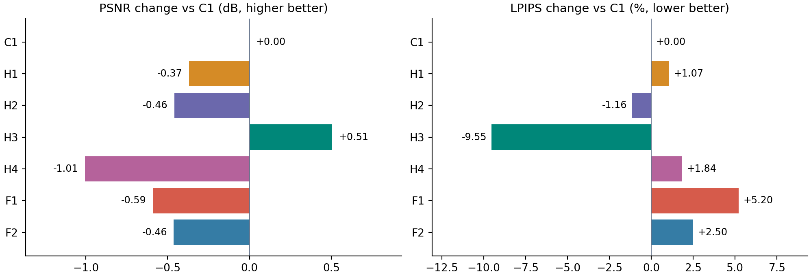
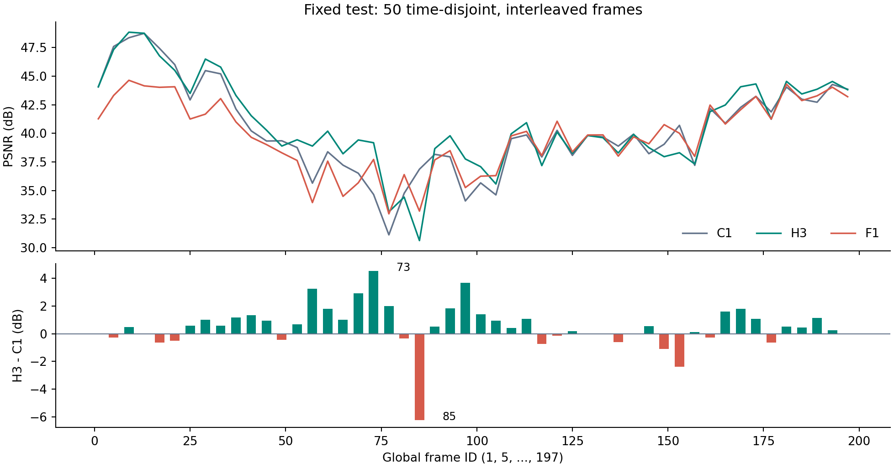
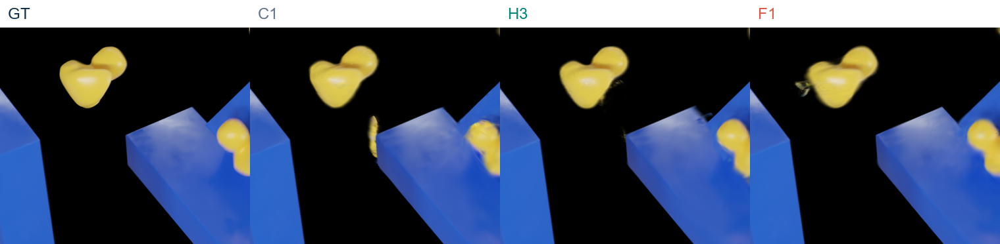
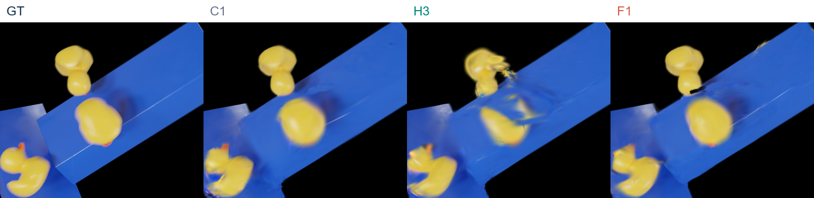
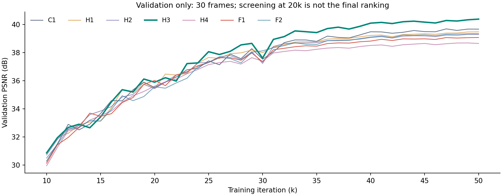

# PIDG 完整度与 ObjectID 实验技术分析

## 1. PIDG 已训练模型技术分析

Rubber Duck | 完整度、外观与运动约束 | 数据核验于 2026-11-01 09:38 GMT

> 当前综合最优为 **H3 = C1 + 平衡覆盖损失 + 弱邻域时间应变约束**。在相同 50 张测试图、final 50k 快照下，H3 的 PSNR、SSIM、LPIPS、MS-SSIM 均优于 C1，平均完整度评分也更低。

| 指标 | C1 对照 | H3 | 变化 |

| --- | --- | --- | --- |

| PSNR ↑ | 40.3721 | 40.8782 | +0.5061 dB |

| LPIPS ↓ | 0.010438 | 0.009441 | -9.55% |

| 内部低覆盖 α<0.9 ↓ | 0.09076% | 0.06059% | -33.24% |

| 背景误覆盖 ↓ | 1.0041% | 0.8036% | -19.97% |

| 平均完整度评分 ↓ | 0.003837 | 0.003404 | -11.30% |

### 如何使用这个结论

以 H3 作为下一轮默认模型，保留 C1 作为稳定对照。F1 作为严格低覆盖和碎片损失的专项候选保留；H1 的前景漏覆盖与完整度评分 P95 更好，但外观和背景覆盖退化，不作为整体替代。

H3 并非逐帧最优：PSNR 改善 33/50 帧，下降 17/50 帧。第 85 帧下降 6.24 dB，仍有明显拖影。H3 的测试碎片损失也略高于 C1，验证集的严格低覆盖率未改善。

本报告主表分析 C1、H1-H4、F1-F2 七组完整度实验；另评估 O1/O2 ObjectID，并回顾 C2/C3 颜色修正、材质、中心与 iso 消融。早期训练协议不同的结果不混入同一排名。

## 2. 比较是否公平：先固定口径

| 项目 | 本报告采用的口径 |

| --- | --- |

| 数据与任务 | Rubber Duck；200 个原始时刻；120 train / 30 validation / 50 test。三者帧号集合两两无交集，合并覆盖 1-200。 |

| 测试时刻 | 固定官方 50 张：原始帧号 1, 5, 9, ..., 197；按原始帧号排列。 |

| 时间与图像 | t=(frame_id-1)/199，训练/验证/测试及物理时间共享；1600×900，量化 PNG 后评估。 |

| 训练预算 | 七组均为总计 50,000 iter，seed=0，width=256、depth=0，无 residual adapter。 |

| 初始状态 | 七组共享完整 3k 检查点；含 Gaussian、网络、优化器及随机状态。C1 直接复用，未重复训练。 |

| 续训的含义 | H1/H4/F1/F2 从各自 20k 全状态恢复至总计 50k；不是在一个已训练 50k 模型上再加 50k。 |

| 模型选择 | 验证集选择各指标最佳快照。主表统一报告 final50k，不按测试结果混选不同 iter。 |

### 不能外推的部分

时刻集合互不重叠，但它们在同一段时间轴交错分布，因此验证的是同场景时间插值与已给相机条件下的重建；不是连续未来时间段预测，也不是新场景泛化。

测试 RGB/alpha 不进入本轮梯度损失，训练损失只使用训练帧。验证图像用于超参、筛选和快照选择。该官方测试集此前已被查看和比较，历史暴露不会因重新划分而消失；本结果不是全新盲测。

只有一个场景和一个随机种子；CUDA 存在非确定性。共享起点提高可比性，但不能替代多随机种子重复实验或证明统计显著性。

## 3. C1 是什么：共同网络与新增项

本报告的 C1 指 **C1_repaired**，不是未经修改的原始 PIDG。它保留 PIDG 的 canonical Gaussian、时空形变场以及速度/应力和动量残差路径，并继承 V3 的全局时间与图像目标。

| 阶段 | 共同结构 |

| --- | --- |

| 编码 | XYZ 哈希：16×2=32 维；XYT/YZT/XZT 三个哈希编码：各 32×2，总计 192 维。 |

| 融合 | 32→256 Linear→Sigmoid→[-1,1] 空间门控，与 192→256 Linear→ReLU 时间分支逐元素相乘。 |

| 输出 | 共享额外隐藏层 depth=0；三个 Linear 头：256→7（warp 四元数+平移）、256→4（旋转增量）、256→3（尺度增量）。 |

| 参数解释 | 上述形变 MLP 含偏置共 61,454 参数，不包含哈希表、Gaussian 参数库、速度/应力网络。depth=0 不表示没有 MLP。 |

| C1 修正包 | SH 辐射使用 Softplus(β=5)，逆变换初始化 DC；L1+DSSIM、LPIPS=0.02；mask L1=0.03、前景 RGB L1=0.1，从 3k 起用 2k 渐增。 |

| 变体 | 在 C1 上额外增加 | 最终点数 |

| --- | --- | --- |

| C1 | 无本轮新增项 | 86143 |

| H1 | 平衡前景覆盖 + 背景抑制 | 84786 |

| H2 | 弱邻域时间应变一致性 | 89017 |

| H3 | H1 + H2 | 87032 |

| H4 | 颜色一致的覆盖定向增密 | 84607 |

| F1 | H3 + 已覆盖前景难像素 RGB 项 | 88092 |

| F2 | F1 的三项新权重全部减半 | 86570 |

H/F 七组没有增大 MLP，也没有加入新的 E 材料参数、ObjectID、iso、速度导数一致性或中心约束。训练目标改变可影响 15k 以前的常规增密，所以最终点数不完全一致。

## 4. H1 / H2：二维覆盖与运动连续性

### H1：对内部缺口和背景溢出分别归一化

令 M 为训练 RGBA 的 GT alpha，a 为渲染 alpha；C 为 7×7 腐蚀后 alpha>0.95 的内部区域，B={M≤0.5}。对前景/背景分别求均值，避免大量背景像素稀释内部监督。

> L_(cov) = mean_(p∈C) ReLU(0.95-a_(p)) + 0.25 mean_(p∈B) a_(p)
权重 0.002；从 3k 开始，4k 渐增至满权重。

它比单一全图 mask L1 更直接处理内部低透明度，并显式抑制背景覆盖。梯度可改变 Gaussian 位置、尺度、不透明度及其形变；并未单独冻结几何，因此必须同时观察颜色与边界。

### H2：相邻训练时刻的邻域距离变化约束

每次采样 96 个锚点，每点 8 个邻居，canonical 半径 0.05。只保留双方 opacity>0.05、DC 颜色距离<0.25，且在首/中/末训练时刻始终相距 10^(-5) 至 0.15 的边。无需真值 object ID，但这些筛选并不等同于正确实例分割。

> d_(ij)(t)=||x_(i)(t)-x_(j)(t)||
e_(ij)=ReLU(|log d_(ij)(t′)-log d_(ij)(t)|-log(1+ε))
L_(strain)=mean Huber_(β=0.1)(e_(ij))
ε=min(0.2, 0.03×|t′-t|×199)，t′ 为相邻训练时刻。

权重 10^(-4)，8k 开始、4k 渐增；每 20 iter 计算并乘 20 补偿。canonical 点位置和筛边过程 detach，梯度主要作用于形变轨迹。距离式约束允许刚体平移/旋转，并为真实拉伸保留容差；它不是强刚性 ARAP，也不是完整应变本构。

## 5. H4 / F1 / F2：为什么更复杂未必更好

### H4：覆盖驱动、颜色过滤的晚期克隆

只在 C1 上增密，不含 H1/H2。16k-36k 累计训练时刻的内部覆盖缺口：(0.95-a)^(+)×C×[a<0.7]；按实际渲染足迹找到已有贡献点，每 2k 决策一次。候选须在至少 3 个不同训练时刻出现，训练 RGB 标准差每通道≤0.15。

每窗口最多补 256 点，保留父点。新点颜色用缺口处训练 RGB 加权平均经 Softplus 逆变换初始化，高阶 SH 清零；初始 opacity 限制在 0.005-0.05。偏移标准差为 0.25×min(scale,0.02)。

> 实际执行 10 个窗口，共新增 **363 点**；final 84,607 点。完全没有贡献点的空射线不能提供 3D 种子；“补点”不等于找到了正确深度或物体归属。

### F1：H3 上增强已覆盖前景的困难颜色像素

先用 GT 前景与 a≥0.8 的交集筛像素，再取 RGB L1 最大的 20% 求均值，权重 0.01。8k 起用 4k 渐增，每 4 iter 计算并补偿。alpha 筛选 detach，但 RGB 损失仍可反传到几何、尺度与 opacity，不能称为“只改颜色”。

F1 从共同 3k 起点按反馈配置训练，并非加载 H3 的 50k 权重续训。F2 将 coverage、strain、tail 权重分别降至 0.001、5×10^(-5)、0.005；F1/F2 均未启用晚期增密。

### 应如何解释失败

增密可能复制已有位置/深度误差并扩大轮廓；困难像素重加权可能改变整体外观与几何之间的平衡；降低权重也会改变优化轨迹。这些是与结果相符的机制假设，当前日志并不能定位唯一因果，更不能证明所有增密或颜色修正都无效。

## 6. 四项图像指标：H3 同时占优

固定 50 张测试图；各图指标先计算，再对 50 张求均值。↑ 越高越好，↓ 越低越好。

| 模型 | PSNR ↑ | Δ dB | SSIM ↑ | LPIPS ↓ | MS-SSIM ↑ |

| --- | --- | --- | --- | --- | --- |

| C1 | 40.3721 | +0.0000 | 0.9946761 | 0.0104375 | 0.9965463 |

| H1 | 40.0027 | -0.3695 | 0.9945776 | 0.0105493 | 0.9965711 |

| H2 | 39.9132 | -0.4590 | 0.9945875 | 0.0103162 | 0.9966189 |

| H3 | 40.8782 | +0.5061 | 0.9950647 | 0.0094411 | 0.9969448 |

| H4 | 39.3669 | -1.0052 | 0.9943725 | 0.0106298 | 0.9964535 |

| F1 | 39.7816 | -0.5905 | 0.9943615 | 0.0109807 | 0.9964935 |

| F2 | 39.9096 | -0.4626 | 0.9944645 | 0.0106980 | 0.9965023 |

图 1：相对 C1 的 PSNR 与 LPIPS 变化。H3 的两项变化方向都更有利。

H3 的 SSIM 比 C1 提升 0.0003886，MS-SSIM 提升 0.0003985。H2 虽然 PSNR 下降约 0.459 dB，但 LPIPS 与 MS-SSIM 略好于 C1，说明不同指标并非完全等价。

H1、H4、F1、F2 没有同时改善四项指标。尤其 H4 的 PSNR 下降约 1.005 dB，不能仅因它执行了增密就判定效果更好。主表没有把其他 iter 的单项最佳指标拼成一个不存在的模型。

本报告不将早期 150 train / test 参与选优、旧时间口径或额外续训预算下的 A/T/W 实验与此表直接排名；它们的差值不能用于归因本轮模块效果。

## 7. “完整度”测量的到底是什么

以下指标均基于 **2D 渲染 alpha 与 GT alpha**；不是 3D 内部体积、封闭性、碰撞或实例分割的真值。M、a∈[0,1]；F={M>0.5}，B={M≤0.5}，P={a>0.5}。C=minimum_filter_(7×7)(M)>0.95，图外填 0，相当于向内排除约 3 像素边界。

| 指标 | 单帧定义（每帧求比例，再平均 50 帧） |

| --- | --- |

| 内部低覆盖 r50 / r90 | \|C ∩ {a<0.5 或 a<0.9}\| / \|C\|。越低，GT 内部达到对应 alpha 的像素越多。不是删除某模块后剩余区域。 |

| 前景漏覆盖 m50 | \|F ∩ {a≤0.5}\| / \|F\|。包含轮廓附近；与腐蚀后的内部低覆盖不同。 |

| 背景误覆盖 b | \|B ∩ P\| / \|B\|。分母是 GT 背景，不是预测前景面积。 |

| Mask IoU | \|F ∩ P\| / \|F ∪ P\|；越高越好。 |

| 不透明外观错误 o | \|F ∩ {a≥0.9} ∩ {mean_RGB \|I-G\|>0.15}\| / \|F\|。用来发现“alpha 填满但颜色不对”。 |

| 碎片损失 f | 对每个面积≥32 像素的 GT 前景连通块，求 1-最大有效预测连通块面积/GT 块面积；再按块、按帧平均。 |

碎片连通使用 4 邻接；预测连通块在 GT 块内求取，并去除面积<max(8, floor(0.001×GT 块面积)) 的小块。因此 f 同时受漏覆盖与碎裂影响，不等于真实物体实例碎片数；接触物体可能在 GT 上属于同一块。

> 完整度评分 S = 0.45r90 + 0.25m50 + 0.20f + 0.10o + 0.10b
所有项用 0-1 比例；该加权和为项目自定义诊断，非标准 benchmark 分数，权重和为 1.10，并非概率。越低越好。

表中带 % 的列为比例×100；百分点差与相对百分比下降必须区分。低覆盖接近零只表示超过 alpha 阈值，不能保证颜色、深度、法线或运动都正确。

## 8. 完整度收益与单项取舍

| 模型 | 内部 r50 % ↓ | 内部 r90 % ↓ | 背景 b % ↓ | IoU ↑ | 评分 S ↓ |

| --- | --- | --- | --- | --- | --- |

| C1 | 0.01082 | 0.09076 | 1.0041 | 0.91610 | 0.003837 |

| H1 | 0.01212 | 0.08387 | 1.2532 | 0.89770 | 0.003999 |

| H2 | 0.00966 | 0.09248 | 1.1736 | 0.90357 | 0.003991 |

| H3 | 0.00367 | 0.06059 | 0.8036 | 0.93148 | 0.003404 |

| H4 | 0.01182 | 0.07898 | 1.3174 | 0.89326 | 0.004169 |

| F1 | 0.00357 | 0.06543 | 1.2820 | 0.89525 | 0.003848 |

| F2 | 0.00981 | 0.11533 | 1.2607 | 0.89716 | 0.004257 |

| 专项诊断 ↓ | C1 | H3 | F1 | 当前最优 |

| --- | --- | --- | --- | --- |

| 碎片损失 f | 0.006564 | 0.006637 | 0.006011 | F1 |

| 最差帧评分 | 0.018817 | 0.009972 | 0.009498 | F1 |

| 评分 P95 | 0.008398 | 0.008316 | 0.007621 | H1: 0.007353 |

| 前景漏覆盖 % | 0.24996 | 0.23989 | 0.23600 | H1: 0.22717% |

H3 的 r50 相对 C1 降低 66.06%，r90 降低 33.24%，背景误覆盖降低 19.97%；IoU 从 0.91610 升至 0.93148。其平均评分、前景 RGB L1 和不透明外观错误也为七组最佳。

但 H3 的碎片损失 0.006637 略高于 C1 的 0.006564；平均 extra_fragments 为 0.010，对照为 0.005。F1 的严格 r50 最低，但与 H3 仅差约 0.000108 个百分点，背景误覆盖却从 H3 的 0.8036% 升至 1.2820%，PSNR 下降约 1.097 dB。

> 综合最优选 H3；若唯一目标是最差帧完整度评分或碎片损失，可保留 F1。不能因为一个阈值指标更接近 0，就忽略颜色、边界和其余时刻。

## 9. 按原始帧号分析，而非按 PSNR 排序

图 2：上图为逐帧 PSNR，下图为 H3-C1 差值；横轴是整个序列的原始帧号。

| 测试帧段 | 改善帧 / 总帧 | 平均 ΔPSNR |

| --- | --- | --- |

| 1-65 | 13 / 17 | +0.6435 dB |

| 69-133 | 11 / 17 | +0.7032 dB |

| 137-197 | 9 / 16 | +0.1507 dB |

H3 的平均差值 +0.5061 dB，中位数 +0.4906 dB，33/50 帧改善。因此提升并非只由一个极端正例产生，但末段收益较小，仍存在局部严重失败。

最大增益：帧 73，C1 34.6570 → H3 39.1782 dB；最大退化：帧 85，C1 36.8655 → H3 30.6273 dB。这两个时刻均为测试图，下面只用于事后诊断，不据此调参后继续把它们当作盲测。

完整逐帧 CSV 保留七组 PSNR 及 H3-C1 差值，便于按时间复查。逐帧数据相互关联，不能把 50 帧简单当作 50 次独立训练重复。

## 10. GT 与渲染：同时展示收益和失败

### 帧 73：H3 减少 C1 的局部伪影（+4.5212 dB）

图 3：GT | C1 | H3 | F1。相同裁切框 x=463-843，y=340-670；坐标按原始 1600×900 图像。

C1 在蓝色平台左上边缘外出现明显黄色条状漂浮物；H3 在该处更接近 GT，F1 仍有小范围黄色/灰色残影。H3 的鸭子表面和轮廓也未完全恢复 GT 的清晰程度。

### 帧 85：H3 仍有形变与颜色拖影（-6.2382 dB）

图 4：GT | C1 | H3 | F1。相同裁切框 x=731-1111，y=300-630。

H3 中上方鸭子出现拉长和破碎状边缘，中部蓝色平台上混入明显黄色拖影；该帧 C1 更接近 GT。这里的问题不只是 alpha 偏低，还包含位置/形变与外观耦合误差。

两个帧分别按 H3 相对 C1 的最大 PSNR 增益/退化选取，框内再按局部 MSE 差最大选区域，属于有意展示的极端正反例，不代表随机样本。图像仅等比例排版与统一裁切，没有增强、锐化或生成式修改。

## 11. 短实验排名不能替代最终验证

图 5：30 张验证图的 PSNR 历史，展示 10k-50k；H3 后期保持领先。

| 模型 | 20k val PSNR | 50k val PSNR | 50k test PSNR |

| --- | --- | --- | --- |

| C1 | 35.5181 | 39.6649 | 40.3721 |

| H3 | 35.8939 | 40.3767 | 40.8782 |

| F1 | 36.0189 | 39.0709 | 39.7816 |

| F2 | 35.5664 | 39.3474 | 39.9096 |

F1 在 20k 的验证 PSNR 高于 H3，但其覆盖质量护栏未全部通过；到 50k，验证/测试均明显落后 H3。自动根据局部短实验提出修正并不保证最终有效，需要保留完整诊断和固定预算对照。

H3 在验证集的 PSNR 比 C1 高约 0.7118 dB，完整度评分也更低，支持其总体收益不是只出现在测试集。但验证 r50 从 C1 的 0.01447% 增至 H3 的 0.01793%，与测试 r50 的改善方向不同，说明极少数缺口会随时刻变化。

H3 的验证 PSNR 最优快照恰为 50k；验证完整度最优快照为 49k，测试 PSNR 为 40.8614 dB。主表坚持 final50k，没有按测试集结果再挑一个最好迭代。

## 12. ObjectID：模块被使用，但未带来收益

O1/O2 与 C1 共享完整 3k 起点、同一划分和 50k 总预算。它们加入 16 个候选运动槽位，将各 Gaussian 的原形变位置与软归属加权的槽位 SE(3) 位置混合；最大组运动占比 25%，原非刚体路径保留 75%。16 是候选容量，不是真实物体数。

O1 冻结 identity MLP，采用几何软归属；仍用当前 X 查询权重，不是人工指定不变实例标签。O2 学习归属；使用图像重建、轨迹残差、熵和槽位占用代价，不使用实例标签或伪实例目标。两者继承 C1 的训练 alpha，因此不能称为完全不含监督的 RGB-only 系统。

| 模型 | PSNR | SSIM | LPIPS | MS-SSIM |

| --- | --- | --- | --- | --- |

| C1 | 40.3721275 | 0.9946761 | 0.0104375 | 0.9965463 |

| O1 | 38.8108253 | 0.9936742 | 0.0116900 | 0.9961096 |

| O2 | 38.4808731 | 0.9932882 | 0.0119670 | 0.9955380 |

| 归属诊断 | O1 | O2 |

| --- | --- | --- |

| 平均最大归属概率 | 0.1722 | 0.3495 |

| pmax≥0.5 的 kernel 比例 | 0% | 14.11% |

| 最终活跃候选槽 | 16 / 16 | 16 / 16 |

实测：O1/O2 相对 C1 分别下降 1.5613 / 1.8913 dB，四项图像指标均更差；尚未出现足够明确的物体归属。打乱归属会改变渲染，只能证明分支参与了前向计算，不能证明得到正确的 object ID。

可能原因：软归属把不同运动混在一起，组 SE(3) 对真实弹性形变引入偏置，归属与运动同时优化存在歧义。日志支持“当前实现未获益”，但没有实例真值，无法把退化唯一归因于分组错误。

> 当前不建议把 O1/O2 叠加到 H3 作为默认配置。后续应先验证分组跨时间稳定性、接触阶段串组和运动残差，再决定是否重新训练。

## 13. 已有其他模块提供了什么线索

| 比较组（均 final50k） | 对照 PSNR | 变体 PSNR | 可支持的结论 |

| --- | --- | --- | --- |

| 颜色修正后的局部仿射 | 40.3721 | C2 39.2914 C3 39.2738 | 加入局部仿射及其上的增密未提升该 C1 对照；H2 时间应变不是旧仿射项。 |

| 固定/可学习共享 E | 40.0373 | P1 37.2739 P2 37.2673 | 各比 P0 低约 2.76-2.77 dB；学习 E 未弥补本构约束导致的退化。 |

| 原 PIDG + 2D 前景中心 | 37.1394 | 37.5279 | PSNR +0.3885 dB，但 SSIM/LPIPS 变差；不是完整 3D 质量中心监督。 |

| V3 + iso=0.001 | 39.7240 | 39.5581 | PSNR -0.1658 dB，LPIPS 变差；SSIM/MS-SSIM 略改善，属于取舍。 |

这些对照同样使用 120/30/50 时间划分，但各自有专门的共同起点和训练配方。P1/P2 应与 P0 比较，G1 应与 G0 比较；不可用它们与 H3 的绝对差直接推断某一个模块的因果贡献。P0 的 PSNR 比复用 C1 低约 0.335 dB，也提醒单次运行差异不可忽略。

旧 C1_mask 的颜色退化经“正值辐射 + 初始化修正 + 延迟 mask + 前景颜色监督”整体修正后，从 35.7459 提升至 40.3721 dB；这是修正包效果，不足以证明其中任意单项独自贡献全部提升。

### 从这些实验得到的共识

更强的约束、更大的参数库、更多点或更接近物理的形式都不自动带来更好渲染。约束需要与实际观测、弹性运动和颜色参数化匹配；先抑制模型“用错误颜色补偿透明度”的机制，再以较弱运动先验辅助覆盖，更符合当前证据。

## 14. 为什么 H3 更好，下一步该改什么

| 已观察到的证据 | 可能机制与适用边界 |

| --- | --- |

| H1/H2 单独均未提高 PSNR；H3 同时提高四项图像指标和平均完整度。 | 二维覆盖给出“该填哪里”，弱时间应变限制“如何随时间移动”；两者可能互补。单种子组合结果支持这个假设，不等于证明协同的唯一原因。 |

| H3 前景 PSNR 31.9512→32.4961；前景平均 MSE 9.376e-4→8.207e-4。 | 前景外观本身在改善，不只是大量背景使全图指标变好；区域 PSNR 与全图 PSNR 采用不同分母。 |

| H3 背景平均 MSE 4.548e-5→4.486e-5；全图平均 MSE 1.344e-4→1.213e-4。 | 整体误差也下降；这里的 MSE 由保存的 PNG 重算，与“逐图 PSNR 均值”不是同一聚合形式，不能由 +0.506 dB 直接宣称固定比例的 pooled MSE 下降。 |

| H3 87,032 点，仅比 C1 多 889（约 1.03%）；无额外晚期增密。 | 收益主要伴随训练目标改变出现，而非增加 MLP 容量；但早期常规增密也随优化变化，不能完全排除点分布的贡献。 |

### 建议保留与修改的优先级

**默认保留 H3，固定 C1 对照。**先用多个随机种子重复 H3/C1，并在独立验证上按时间块而非单帧检查严重失败；不要立即叠加 ObjectID、E 或晚期增密扩大变量数量。

**优先处理接触与大形变阶段。**帧 85 的形变/颜色拖影提示应检查邻边是否跨物体、运动容差是否足够，以及颜色与 opacity 梯度是否冲突。诊断与改动应先在验证帧上进行；测试帧 85 保留为已暴露案例。

**若试修颜色或增密，先做受控实验。**F1 可比较只更新颜色与全参数更新；H4 可先可视化新点来源、深度与所属运动，再考虑多时刻累积和增密时序。以上是待检验方案，不是已证实有效的改动。

## 15. 报告、模型与 render 的绝对地址

### 七组 GT / render 拼接总览（50 张）

F:\A_Edinburgh\PhysGauss\runs\pidg_integrity_continuation\render_exports\final50000\gt_all_models\index.html

总览排列：GT | C1 | H2 | H3 | H1 | H4 | F1 | F2。每个变体另存 renders（纯渲染）及 gt_render（双图拼接）；文件序号 00000-00049 对应原始帧号 1,5,...,197。

**H3 纯 render**

F:\A_Edinburgh\PhysGauss\runs\pidg_integrity_continuation\render_exports\final50000\H3_combined\renders

**H3 与 GT 拼接**

F:\A_Edinburgh\PhysGauss\runs\pidg_integrity_continuation\render_exports\final50000\H3_combined\gt_render

**H3 Gaussian 与形变权重目录**

F:\A_Edinburgh\PhysGauss\runs\pidg_integrity_tuning\H3_combined\rubber_duck

**ObjectID GT/render 总览**

F:\A_Edinburgh\PhysGauss\runs\pidg_object_id\render_exports\final50000\gt_c1_frozen_learned\index.html

H3 权重位于上述模型目录的 point_cloud\iteration_50000\point_cloud.ply 与 deform\iteration_50000\deform.pth；完整恢复状态为 checkpoints\resume.pt。

### 可复核的数字与源码

主要数据：experiments/integrity_continuation/assessment.json；各 run 的 results.json、per_view.json、metric_config.json、metric_history.jsonl、coverage_density.jsonl。ObjectID：experiments/object_id/identity_exports.json。

实现：variants/integrity_tuning/{model,runtime}.py；variants/integrity_feedback/{model,runtime}.py；variants/color_repair/{runtime,model,color}.py；variants/object_id/{model,runtime}.py。共享 3k SHA256：

6da523ea247b4068ec9bd6a7c8f83dacb7506c698daaeecc9eb0ecd93ea1ebce

本报告旁附同名 Markdown。integrity_analysis_assets/data.json 保存审计数据与来源 SHA256；per_frame_test.csv 保存逐帧 PSNR；crops.json 保存裁切坐标。生成脚本为 scripts/collect_integrity_report_data.py、build_integrity_report_figures.py、build_integrity_technical_report.py。

结论范围：当前单场景、单种子已完成实验中的综合最优。没有声称识别真实材质、恢复真实实例、消除所有 3D 空洞，或证明新场景与未来时刻泛化。
