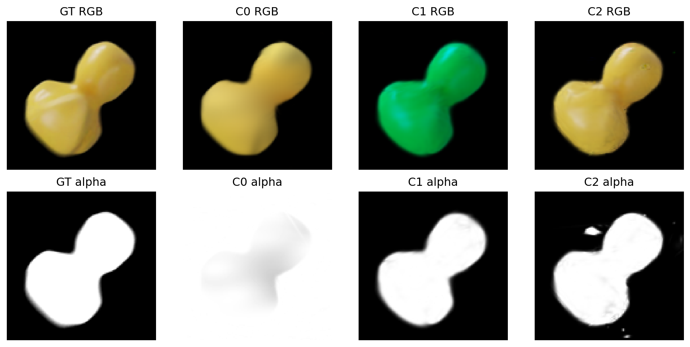

# PIDG 覆盖与邻域消融实验报告

## 覆盖更准，为何图像反而变差？

C0-C5 已完成训练结果与代码机制分析 | 2026-10-27

C0-C5 已完成训练结果与代码机制分析 | 2026-10-27

### 六组究竟改变了什么

| 组别 | Mask L1 | 局部仿射约束 | 定向增密 |
| --- | --- | --- | --- |
| C0 / V3 | 0 | 0 | 关闭 |
| C1 | 0.1 | 0 | 关闭 |
| C2 | 0.1 | 0.0001 | 关闭 |
| C3 | 0.1 | 0.0001 | 开启 |
| C4 | 0 | 0.0001 | 关闭 |
| C5 | 0 | 0 | 开启 |

### 统一比较条件

Rubber Duck；相同 W256_D0 网络、V3 RGB 损失与共同时间轴。每组从完全相同的随机 step0 状态训练 50k，C0 复用已完成的对照。Iso 和速度一致性均关闭。120 训练 /30 验证 /50 测试，图像与时刻互不重叠；测试为交错未见时刻插值。

主表统一使用最终 50k 快照，四个 best 仅按验证集选择，不根据测试指标改选。正式输出为 1600x900 PNG。新增项主要是训练损失和点分配策略，未扩大 MLP；增密会改变 Gaussian 数量。

重要边界：场景有多只鸭子及障碍物。C2/C3/C4 未接入真实物体 ID 隔离，属于未分物体的空间邻域消融，不能声称已避免跨物体连接。

## 最终 RGB 指标：基准 PSNR 最高

固定50张测试图；PSNR/SSIM/MS-SSIM 越高越好，LPIPS 越低越好

固定50张测试图；PSNR/SSIM/MS-SSIM 越高越好，LPIPS 越低越好

| 组别 | PSNR | SSIM | LPIPS | MS-SSIM |
| --- | --- | --- | --- | --- |
| C0 | 39.7240 | 0.994333 | 0.010681 | 0.996196 |
| C1 | 35.7459 | 0.992724 | 0.013329 | 0.992781 |
| C2 | 37.1511 | 0.993076 | 0.012812 | 0.994440 |
| C3 | 35.8634 | 0.992693 | 0.013303 | 0.992737 |
| C4 | 38.6373 | 0.993881 | 0.011221 | 0.995312 |
| C5 | 39.3918 | 0.994361 | 0.010570 | 0.996165 |

### 独立作用与条件作用要分开看

| 比较 | 含义 | PSNR 差 /dB | 改善帧 /50 |
| --- | --- | --- | --- |
| C1-C0 | 仅 Mask | -3.9780 | 4 |
| C4-C0 | 仅邻域 | -1.0866 | 17 |
| C5-C0 | 仅增密 | -0.3321 | 17 |
| C2-C1 | Mask 后加邻域 | +1.4052 | 27 |
| C3-C2 | 再叠加增密 | -1.2877 | 25 |

C5 的 SSIM 和 LPIPS 略好于 C0，但 PSNR 与 MS-SSIM 略差，因此是局部指标权衡。C2 相对 C1 改善约 1.41 dB，仍比 C0 低约 2.57 dB，不能把“弥补退化”称为超过基准。

C3 虽在25/50帧上优于C2，平均仍下降1.29 dB。原始169-197的最后8个测试时刻平均下降5.57 dB，贡献了约69%的总体均值退化，说明失败集中在部分时段。

这些是单次运行的观测差异。后文发现，在新增项真正启用之前曲线已分岔，因此表中差值不能直接当成严格因果增益。

## Alpha 指标揭示另一种权衡

轮廓、内部覆盖与 RGB 质量不是同一个目标

轮廓、内部覆盖与 RGB 质量不是同一个目标

| 组别 | 前景 PSNR | Mask IoU | 内部低覆盖 % | 背景误覆盖 % |
| --- | --- | --- | --- | --- |
| C0 | 30.677 | 0.2064 | 0.00185 | 45.60 |
| C1 | 26.442 | 0.9764 | 0.77157 | 0.13 |
| C2 | 28.191 | 0.9842 | 0.03712 | 0.13 |
| C3 | 26.914 | 0.9684 | 0.93528 | 0.19 |
| C4 | 29.521 | 0.2168 | 0.00301 | 52.65 |
| C5 | 30.299 | 0.2360 | 0.00054 | 39.51 |

原始153帧的完整 alpha。白色表示高不透明度；显示范围统一为0-1，未按模型单独归一化。

C0 的低内部空洞率伴随很低的轮廓 IoU。补充诊断显示它在 GT 背景也保留大量高 alpha：背景变黑不等于背景透明。Mask 能去掉这类误覆盖，但并不自动保证鸭子内部颜色、位置与遮挡顺序正确。

低覆盖率只检测透明缺口。高 alpha 的黑色像素也可能看起来像“洞”，但由颜色或遮挡错误形成的这类缺陷不会被计入低覆盖率，仍需检查前景 RGB 误差。

定义：IoU 使用 alpha>0.5；内部低覆盖率在 GT alpha>0.95 的3像素腐蚀区域统计预测 alpha0.5。前景 PSNR 使用 GT alpha>0.5。均为逐帧平均。

## 曲线审计：增密前已存在差异

共同随机初始化并不等于 GPU 训练全过程逐位一致

共同随机初始化并不等于 GPU 训练全过程逐位一致

每1k验证一次。后期验证指标改善趋缓，模型落在不同重建水平；只有验证曲线，不能据此断言过拟合。

阴影区域为首次补点前。覆盖证据从16k采样，首次实际新增 Gaussian 在18k，且18k验证发生在补点之前。

| 验证 PSNR 差 | 15k：补点前 | 50k：最终 |
| --- | --- | --- |
| C5-C0 | +0.5377 | -0.2928 |
| C3-C2 | -0.7969 | -1.4830 |

C3 在补点前就落后 C2 约0.80 dB；C5 在补点前反而领先 C0 约0.54 dB。因此最终差异不全是补点造成。具体非确定性来源尚未定位，自定义 CUDA 累加与增密阈值放大是候选因素。

邻域项也有同类限制：3k首次启用前，C4-C0 和 C2-C1 已分别相差约-0.08和+0.07 dB。更可靠的归因需要共同状态分叉及多 seed 重复。

## 同一帧的 RGB 与逐帧表现

原始帧153 /导出00038；沿用此前讨论的困难帧，统一 GT 定义裁剪

原始帧153 /导出00038；沿用此前讨论的困难帧，统一 GT 定义裁剪

GT 和 C0-C5 使用相同裁剪坐标。最后一格是 C1 的逐像素 RGB 平均绝对误差，色标范围固定0-0.25；该帧仅作问题定位。

全部50个测试时刻的 PSNR；横轴为原始帧号，线段不代表计算了训练/验证帧的测试指标。

该帧 C1 出现明显颜色偏差，C2/C3 仍有局部形状或遮挡误差。可见“alpha 接近 GT”不保证颜色也正确。场景的多物体结构同时说明，只有距离门控不能证明邻域属于同一个物体。

蓝色障碍物上的黑色缺口提醒我们：视觉上的“洞”可能是透明缺口，也可能是高 alpha 的错误颜色或遮挡，需与上一页的 alpha 图一起判断。

## 技术细节一：前景覆盖损失

C1/C2/C3 使用；训练 alpha 是软轮廓监督，不是缺帧实验中的随机删图

C1/C2/C3 使用；训练 alpha 是软轮廓监督，不是缺帧实验中的随机删图

### 监督数据与计算路径

独立读取120张训练 RGBA 原图的 A 通道，双三次缩放到相机分辨率，再除以255。RGB 加载与黑背景合成保持原路径；mask 不是 SAM 分割或光流有效性图。train membership 检查阻止验证/测试 mask 进入训练损失，评估用 alpha 仅用于事后诊断。

本轮 L_V3 保留像素 L1、SSIM、已有物理/网格正则，并含权重0.02的 LPIPS 感知项。LPIPS 每4步计算，按间隔乘4补偿；覆盖损失则每一步计算，从第1步启用，没有前景/背景平衡、边界加权或延迟 ramp。Iso 和速度轨迹一致性权重均为0。

### 梯度究竟更新什么？

可见且未被裁剪/饱和的贡献者，通过 alpha 反传到不透明度、位置、尺度和旋转等渲染变量；形变网络启用后，也会经动态中心及协方差收到梯度。mask 不含颜色目标，在理想 alpha 合成图中对 SH 颜色系数的直接导数为0；SH 仍由 RGB 损失更新。

这与“mask 不会影响颜色”不同：位置、尺度、alpha 和遮挡决定哪些 SH 颜色对像素有贡献，改变它们就会改变颜色损失与颜色梯度。mask 只要求二维轮廓与不透明度，不确定正确深度、物体对应、遮挡排序或颜色。

### 实现可核查的位置

coverage_tuning/data.py: read_alpha；model.py: mask_loss；runtime.py: coverage_loss；code/train_pidg.py: 在统一 loss.backward() 前加权合并。关闭 mask_weight 时不产生此项。

## 技术细节二：弱局部仿射一致性

C2/C3/C4 使用；允许真实拉伸，不是固定邻居距离的刚体约束

C2/C3/C4 使用；允许真实拉伸，不是固定邻居距离的刚体约束

### 构造邻域与局部坐标

每次选128个随迭代轮换的确定性 anchor，在当前 canonical 点云中寻找最多8个欧氏近邻；仅保留距离小于0.1世界单位的边。X 是 detach 后的 canonical 坐标，y(t) 是由当前形变得到的中心位置；平移经相对偏移相消。

均值只统计有效边；至少4条边且最小奇异值大于最大奇异值的1e-4时才使用该邻域。伪逆 rtol=1e-4。D、其伪逆与归一化尺度 detach；E 和拟合 B 对形变保留可微，因此梯度传给轨迹，canonical 坐标不被此正则直接更新。

### 调度、允许的变化与边界

3k后每10步计算一次，2k步内从0线性升到全权重。计算步实际系数为 1e-4 × 10 × ramp，用于补偿采样间隔。该约束允许局部旋转、均匀伸缩和剪切；没有 det(F)=1、体积守恒或本构应力约束。矩阵 B 是局部拟合工具，不等于已验证的物理 F。

非仿射弯曲、接触边界和不同物体相对运动也可能产生残差。真实训练没有传入 object_ids，虽有半径门控，仍不能保证同一表面或同一物体。原 single_object 声明未核验场景，已在结果解释中更正；C4采用知情声明，但仍不含身份隔离。

实现：model.py 的 neighborhoods/local_affine_loss；runtime.py 的 trajectory 与 ramp。刚体/仿射变换不罚、非仿射梯度与退化邻域已有单测；这些测试不证明实际训练邻接无误。

## 技术细节三：覆盖驱动的后期增密

C3/C5 使用；按多个训练时刻的覆盖缺口选父点，而非直接生成空白区几何

C3/C5 使用；按多个训练时刻的覆盖缺口选父点，而非直接生成空白区几何

### 从像素缺口累计到已有 Gaussian

GT alpha>0.95 的前景做3像素腐蚀，减少轮廓边界干扰。16k-35,999每20步采样，像素网格步长4；每个像素最多读取20个实际 footprint 贡献者。当前实现给列表内每个有效 ID 累加相同缺口值，并非按其 RGB/alpha 贡献权重归一化分配。同一时刻重复采样只算一票，但累计分数会增加。

### 补点、继承与预算

18k、20k直至36k，每2k清算一次，按 S_i 排序，最多克隆512个父点，总点数上限200,000。窗口结束后分数与时刻票重置。孩子在 canonical 坐标上加零均值高斯抖动，每轴标准差为0.5×min(parent scale, 0.02)；0.02并非位移范数的硬上限。

孩子继承 SH 颜色、尺度、旋转、粒子/速度索引及动态标记；不透明度初始化为父值夹到[0.01,0.1]。保留所有父点，不额外做后期 opacity reset 或剪枝；原常规梯度增密/剪枝仍在15k结束。新增发生在 optimizer step 后，以免替换参数时丢失本步梯度。

### 它可以和不可以解决什么

可强化已有弱覆盖足迹，并跨时刻筛掉单帧偶发缺口。完全无贡献者的像素没有可克隆父点，也没有可靠深度，因此直接跳过；并不能从零重建任意空洞。继承错误 SH、位置或轨迹也可能复制错误。C3/C5实际新增879/717点，是保守增量而非整体重建。

实现：runtime.py 的 observe_coverage/after_update 与 density.py 的 CoverageAccumulator。状态侧车保存累计分数和逐点逐时刻投票，并与完整断点校验绑定；选择与克隆在 no_grad 下执行。

## Mask 为何会间接改变预测颜色？

由当前渲染结构推导的机制；不是已经定位到单个出错 Gaussian 的因果结论

由当前渲染结构推导的机制；不是已经定位到单个出错 Gaussian 的因果结论

### 1. 颜色与 alpha 共享同一套可见性权重

c_i 来自每个 Gaussian 的 SH 系数，并非形变 MLP 的 RGB 输出。本轮形变分支输出中心变换、旋转与尺度，没有独立随时间的颜色残差。即使 SH 不被 mask 直接更新，mask 对 a_i、位置及协方差的更新仍会改变 w_i，进而改变混合颜色、遮挡以及后续 SH 梯度。排序切换是非光滑情况，不能用上式导数完全描述。

### 2. 轮廓对了，贡献者仍可能错

同一个 A≈1 可以由许多不同的深度、颜色和 Gaussian 组合实现。若错误颜色的点遮住正确点，alpha 已经饱和，mask 无法识别；被遮挡点的 w_i 变小，其 RGB 纠错信号也会弱。黑背景下，C≈0既可由透明背景，也可由高 alpha 的近黑颜色实现；额外 mask 会打破部分 RGB 等价解，促使几何与颜色重新分配。

### 3. 早期启用与离散增密可能放大差异

mask 第1步启用，但 iter<3000 时 d_xyz、d_rotation、d_scaling 为0。随机采样多个运动时刻，却暂用同一静态点云，轮廓目标可能相互冲突。mask 还能进入屏幕位置梯度，而15k前的常规增密正依赖该梯度；因此不仅修改 opacity，也可能提前改变点数和颜色的空间分配。两条路径均由代码支持，尚未通过对照证明是本次变色主因。

## 颜色错误：已有证据与待验证解释

原始帧153的左侧鸭子；所有模型使用同一 GT 定义的区域与像素选择

原始帧153的左侧鸭子；所有模型使用同一 GT 定义的区域与像素选择

上排 RGB、下排 alpha；统一裁剪 x=620:735、y=350:465。C1在高不透明度区域也有颜色偏差，说明单纯补足 alpha 不足以纠正颜色。

| 图像 | 平均 R / G / B | 平均 alpha | RGB MAE |
| --- | --- | --- | --- |
| GT | 0.733 / 0.625 / 0.269 | 0.9847 | 0.0000 |
| C0 | 0.728 / 0.624 / 0.264 | 0.9454 | 0.0276 |
| C1 | 0.000 / 0.617 / 0.264 | 0.9644 | 0.2630 |
| C2 | 0.729 / 0.620 / 0.263 | 0.9716 | 0.0260 |

表中仅统计固定框内 GT 的 R>100、G>90、B<130 的3850个像素；这是事后定位统计，未加入训练，不保证像素对应同一材料点。整组证据仍是50帧指标：C1轮廓 IoU显著提高，但前景 PSNR下降约4.23 dB。

### 不能从这一张图直接下什么结论？

C1 的红通道在这3850个像素中全部为0，而 G/B 均值接近 GT。该现象提示通道截断比简单“颜色混合”更值得优先检查，但8-bit PNG不能证明原始 SH 值为负。不能断言 mask 直接染色或0.1一定太大；其他候选包括贡献者错配、早期静态冲突与梯度竞争。

验证优先级：同一完整状态分叉后比较 mask开/关；分别冻结几何或 SH；记录 RGB/Mask 对共享参数的梯度范数与余弦；对照3k后延迟/ramp与更小权重；追踪该区域贡献者的颜色、深度和身份。以上均为建议，未开展新训练。

## 更具体的线索：SH 颜色的截断区

红通道归零与源码中的零梯度分支吻合；仍需要贡献者级别数据确认

红通道归零与源码中的零梯度分支吻合；仍需要贡献者级别数据确认

### 源码能确认的事实

本轮 convert_SHs_python=False，颜色在 CUDA rasterizer 中由 SH 求值。forward.cu 的 computeColorFromSH 将 SH 结果加0.5，然后逐通道 max(result,0)；并记录 result<0 的 clamped 标志。backward.cu 将这些通道的 dL_dRGB 乘0，再计算 SH 及视线方向相关梯度。

### 为什么与本次“黄色变绿”有关？

在当前固定区域，GT 平均 R=0.733，C1 的3850个对应像素 R=0，G/B仍接近 GT，alpha≈0.964。若主要可见贡献者的红色 SH 进入负值区，就可能保持高 alpha，却缺失红光，从而显得偏绿。mask 本身不监督红色，无法从 alpha 正确与否辨别这类颜色错误。

一种可检验的链条是：mask 先改变几何/可见性与梯度分配，RGB 优化或视角变化使部分通道进入截断区，再因局部零梯度而难恢复。但我们没有记录首次进入负区的时刻，也没有本帧逐贡献者的 q_i、权重和 clamp 标志，因此不能确认这条链已实际发生，更不能说所有绿色都是截断导致。

### 下一步如何证实或排除？

用只读诊断重渲染浮点 RGB，并导出这一区域可见贡献者的原始 SH 求值、clamp 标志和混合权重；统计负红值贡献权重比例。8-bit R=0也可能来自很小正值被量化，需先排除。再按固定初始化/同一状态分叉，对照延迟 mask 与平滑正值颜色参数化；这是未来实验建议，当前未修改激活或重新训练。

不能把“零梯度”理解为永久不可恢复：其他视角/时刻、几何与贡献者变化及优化器动量仍可能改变结果。准确说法是该样本、该通道的 SH 颜色路径被局部截断。

源码依据：third_party/PIDG/submodules/flow-based-diff-gaussian-rasterization/cuda_rasterizer/forward.cu:65-70；backward.cu:29-34、48-97。相关文件 SHA-256 已计入来源记录。

## 为什么会这样：证据与推断分开

结合技术分析与颜色诊断；下面不是已验证的唯一原因

结合技术分析与颜色诊断；下面不是已验证的唯一原因

### 1. Mask 改变了可用的重建方式

证据：C1 的轮廓 IoU 从 C0 的0.2064提高到0.9764，但全图 PSNR 下降约3.98 dB，前景 PSNR 也下降约4.23 dB，说明退化并非只发生在背景。

机制解释：黑背景下，RGB 合成允许高 alpha、近黑颜色的 Gaussian 仍呈现黑色。额外 alpha 监督会压制这种解，并同时改变尺度、透明度、位置和形变的梯度。它更接近轮廓目标，却可能打乱原本有利于 RGB 的分配。Mask 权重0.1从第1步作用于全图，背景约占90%；这是值得检验的梯度权衡，但没有权重扫描，不能断言0.1必然过大。

### 2. 邻域项既能稳定，也会限制表达

证据：C2 相对 C1 改善 RGB 和内部覆盖；C4 单独加邻域却低于 C0。候选解释是：局部协同能约束 Mask 条件下的不协调运动，但也会抑制需要更复杂非仿射变化的局部细节。场景有多个物体，而当前 canonical 欧氏近邻没有身份隔离，还可能错误耦合接触物体；本轮没有标签证实实际跨物体边数。

### 3. 多一些点并不自动补出正确几何

证据：C3 实际加879点，C5加717点，最终分别为70,258和70,848点；C0为75,542点。常规增密阶段已经造成点数差异，所以“定向增密组”最终未必比基准更多。策略只复制弱覆盖像素已有贡献者附近的点；无贡献者的真正空白区无法确定深度，继承颜色/尺度/轨迹也可能延续错误。

C3 相对 C2 退化不能全部归因于增密；启用前已有差距。C5 只在部分指标接近或略超 C0，尚无全面、稳定的重建增益证据。

## 下一步：先修正验证方式，再调强度

建议顺序；本报告不启动任何新的训练

建议顺序；本报告不启动任何新的训练

| 优先级 | 可执行对照 | 解决什么问题 |
| --- | --- | --- |
| 1 | 为每个增密对照使用同一个15k完整状态分叉；保持总预算50k，再做至少3个seed。 | 消除补点前已分岔的混杂，确认约0.3 dB差异是否可复现。 |
| 2 | 从随机初始化对照较弱 Mask 权重及延迟/ramp，记录 RGB/Mask 对相同参数的梯度范数。 | 检验轮廓约束强度和启用时机，而非直接归咎模型容量。 |
| 3 | 已知物体ID/可靠邻接过滤，并在 Gaussian 克隆时传播ID；做边界和接触区域检查。 | 排除跨物体约束；不以颜色或距离直接宣称物体身份。 |
| 4 | 对比 alpha 假阳性/假阴性、前景RGB与局部误差；单独记录新点贡献及实际覆盖改善。 | 防止低空洞率被大面积不透明背景“刷好”，检验补点是否有效。 |

### 目前可以保留什么

C0 继续作为 RGB 主基准；C5 可保留为轻量增密候选，但不设成默认改进。Mask 显著改善轮廓，应保留为可调监督项，而不是直接判定无用。邻域项应先解决邻接可靠性，再判断是否值得加入最终模型。

### 结论的边界

只有一个场景和一个 seed，没有重复实验置信区间；Gaussian 数量是优化结果而非固定容量。当前是交错时刻插值，非长时间缺口或未来预测。测试集有历史和本轮用户授权的提前查看，不能视为完全未触碰测试集。没有 GT 深度、速度或力的恢复结论。

训练与验证使用严格分离的120/30帧，固定50测试帧只用于本报告的评价；四个 best 均来自验证选择。本报告主表统一 final50k，避免通过测试结果重新挑选快照。

## 渲染文件保存在哪里

以下均为绝对地址；每组5种快照共250张拼接图，图库可切换快照和帧

以下均为绝对地址；每组5种快照共250张拼接图，图库可切换快照和帧

### C0 / C0_V3_reference

F:\A_Edinburgh\PhysGauss\runs\pidg_coverage_tuning\render_comparisons\C0_V3_reference\index.html

F:\A_Edinburgh\PhysGauss\runs\pidg_coverage_tuning\C0_V3_reference\rubber_duck\test\ours_50000\renders

### C1 / C1_mask

F:\A_Edinburgh\PhysGauss\runs\pidg_coverage_tuning\render_comparisons\C1_mask\index.html

F:\A_Edinburgh\PhysGauss\runs\pidg_coverage_tuning\C1_mask\rubber_duck\test\ours_50000\renders

### C2 / C2_mask_affine

F:\A_Edinburgh\PhysGauss\runs\pidg_coverage_tuning\render_comparisons\C2_mask_affine\index.html

F:\A_Edinburgh\PhysGauss\runs\pidg_coverage_tuning\C2_mask_affine\rubber_duck\test\ours_50000\renders

### C3 / C3_mask_affine_density

F:\A_Edinburgh\PhysGauss\runs\pidg_coverage_tuning\render_comparisons\C3_mask_affine_density\index.html

F:\A_Edinburgh\PhysGauss\runs\pidg_coverage_tuning\C3_mask_affine_density\rubber_duck\test\ours_50000\renders

### C4 / C4_affine_only

F:\A_Edinburgh\PhysGauss\runs\pidg_coverage_isolated\render_comparisons\C4_affine_only\index.html

F:\A_Edinburgh\PhysGauss\runs\pidg_coverage_isolated\C4_affine_only\rubber_duck\test\ours_50000\renders

### C5 / C5_density_only

F:\A_Edinburgh\PhysGauss\runs\pidg_coverage_isolated\render_comparisons\C5_density_only\index.html

F:\A_Edinburgh\PhysGauss\runs\pidg_coverage_isolated\C5_density_only\rubber_duck\test\ours_50000\renders

GT 在 renders 的同级 gt 文件夹；alpha 在同级 alpha；最终50k拼接在图库目录的 pairs/50000。其他快照为 best、metric_ssim、metric_lpips、metric_ms_ssim。

### GT + 六模型合并图库：50张 / final50k

F:\A_Edinburgh\PhysGauss\runs\pidg_coverage_comparison\final50000\index.html

来源：各模型 results.json、per_view.json、coverage_metrics_test.json、metric_history.jsonl、metric_best.json、配置、初始化与渲染校验记录，以及当前 runtime/model/density 源码。完整 SHA-256 与逐帧诊断见配套 sources.json 和 assessment.json。
