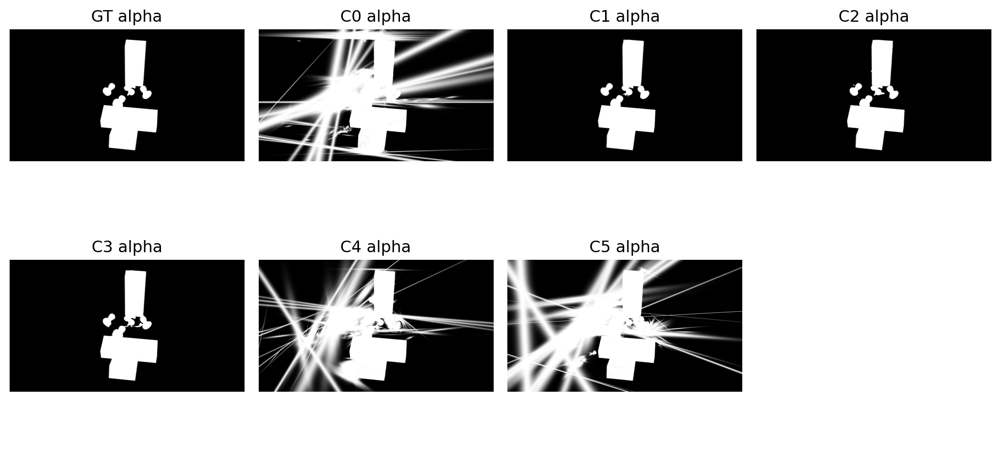
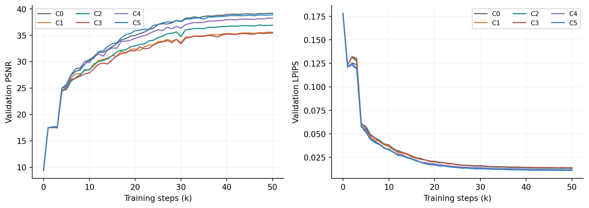
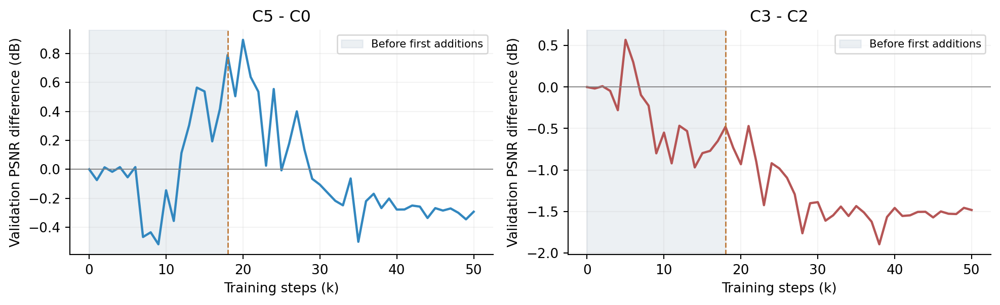
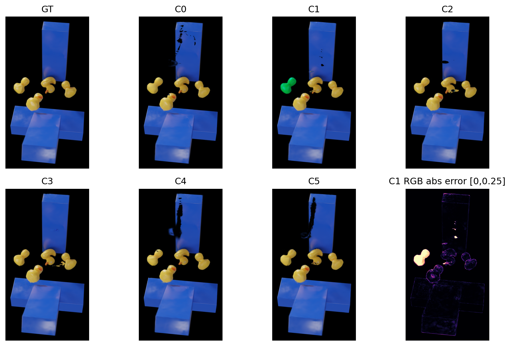
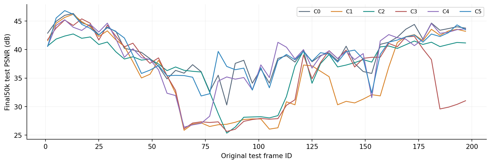

# PIDG 覆盖与邻域消融实验报告

## 覆盖更准，为何图像反而变差？

C0-C5 已完成训练结果与代码机制分析 | 2026-10-27

C0-C5 已完成训练结果与代码机制分析 | 2026-10-27

### 六组究竟改变了什么

| 组别 | Mask L1 | 局部仿射约束 | 定向增密 |
| --- | --- | --- | --- |
| C0 / V3 | 0 | 0 | 关闭 |
| C1 | 0.1 | 0 | 关闭 |
| C2 | 0.1 | 0.0001 | 关闭 |
| C3 | 0.1 | 0.0001 | 开启 |
| C4 | 0 | 0.0001 | 关闭 |
| C5 | 0 | 0 | 开启 |

### 统一比较条件

Rubber Duck；相同 W256_D0 网络、V3 RGB 损失与共同时间轴。每组从完全相同的随机 step0 状态训练 50k，C0 复用已完成的对照。Iso 和速度一致性均关闭。120 训练 /30 验证 /50 测试，图像与时刻互不重叠；测试为交错未见时刻插值。

主表统一使用最终 50k 快照，四个 best 仅按验证集选择，不根据测试指标改选。正式输出为 1600x900 PNG。新增项主要是训练损失和点分配策略，未扩大 MLP；增密会改变 Gaussian 数量。

重要边界：场景有多只鸭子及障碍物。C2/C3/C4 未接入真实物体 ID 隔离，属于未分物体的空间邻域消融，不能声称已避免跨物体连接。

## 最终 RGB 指标：基准 PSNR 最高

固定50张测试图；PSNR/SSIM/MS-SSIM 越高越好，LPIPS 越低越好

固定50张测试图；PSNR/SSIM/MS-SSIM 越高越好，LPIPS 越低越好

| 组别 | PSNR | SSIM | LPIPS | MS-SSIM |
| --- | --- | --- | --- | --- |
| C0 | 39.7240 | 0.994333 | 0.010681 | 0.996196 |
| C1 | 35.7459 | 0.992724 | 0.013329 | 0.992781 |
| C2 | 37.1511 | 0.993076 | 0.012812 | 0.994440 |
| C3 | 35.8634 | 0.992693 | 0.013303 | 0.992737 |
| C4 | 38.6373 | 0.993881 | 0.011221 | 0.995312 |
| C5 | 39.3918 | 0.994361 | 0.010570 | 0.996165 |

### 独立作用与条件作用要分开看

| 比较 | 含义 | PSNR 差 /dB | 改善帧 /50 |
| --- | --- | --- | --- |
| C1-C0 | 仅 Mask | -3.9780 | 4 |
| C4-C0 | 仅邻域 | -1.0866 | 17 |
| C5-C0 | 仅增密 | -0.3321 | 17 |
| C2-C1 | Mask 后加邻域 | +1.4052 | 27 |
| C3-C2 | 再叠加增密 | -1.2877 | 25 |

C5 的 SSIM 和 LPIPS 略好于 C0，但 PSNR 与 MS-SSIM 略差，因此是局部指标权衡。C2 相对 C1 改善约 1.41 dB，仍比 C0 低约 2.57 dB，不能把“弥补退化”称为超过基准。

C3 虽在25/50帧上优于C2，平均仍下降1.29 dB。原始169-197的最后8个测试时刻平均下降5.57 dB，贡献了约69%的总体均值退化，说明失败集中在部分时段。

这些是单次运行的观测差异。后文发现，在新增项真正启用之前曲线已分岔，因此表中差值不能直接当成严格因果增益。

## Alpha 指标揭示另一种权衡

轮廓、内部覆盖与 RGB 质量不是同一个目标

轮廓、内部覆盖与 RGB 质量不是同一个目标

| 组别 | 前景 PSNR | Mask IoU | 内部低覆盖 % | 背景误覆盖 % |
| --- | --- | --- | --- | --- |
| C0 | 30.677 | 0.2064 | 0.00185 | 45.60 |
| C1 | 26.442 | 0.9764 | 0.77157 | 0.13 |
| C2 | 28.191 | 0.9842 | 0.03712 | 0.13 |
| C3 | 26.914 | 0.9684 | 0.93528 | 0.19 |
| C4 | 29.521 | 0.2168 | 0.00301 | 52.65 |
| C5 | 30.299 | 0.2360 | 0.00054 | 39.51 |

原始153帧的完整 alpha。白色表示高不透明度；显示范围统一为0-1，未按模型单独归一化。

C0 的低内部空洞率伴随很低的轮廓 IoU。补充诊断显示它在 GT 背景也保留大量高 alpha：背景变黑不等于背景透明。Mask 能去掉这类误覆盖，但并不自动保证鸭子内部颜色、位置与遮挡顺序正确。

低覆盖率只检测透明缺口。高 alpha 的黑色像素也可能看起来像“洞”，但由颜色或遮挡错误形成的这类缺陷不会被计入低覆盖率，仍需检查前景 RGB 误差。

定义：IoU 使用 alpha>0.5；内部低覆盖率在 GT alpha>0.95 的3像素腐蚀区域统计预测 alpha0.5。前景 PSNR 使用 GT alpha>0.5。均为逐帧平均。

## 曲线审计：增密前已存在差异

共同随机初始化并不等于 GPU 训练全过程逐位一致

共同随机初始化并不等于 GPU 训练全过程逐位一致

每1k验证一次。后期验证指标改善趋缓，模型落在不同重建水平；只有验证曲线，不能据此断言过拟合。

阴影区域为首次补点前。覆盖证据从16k采样，首次实际新增 Gaussian 在18k，且18k验证发生在补点之前。

| 验证 PSNR 差 | 15k：补点前 | 50k：最终 |
| --- | --- | --- |
| C5-C0 | +0.5377 | -0.2928 |
| C3-C2 | -0.7969 | -1.4830 |

C3 在补点前就落后 C2 约0.80 dB；C5 在补点前反而领先 C0 约0.54 dB。因此最终差异不全是补点造成。具体非确定性来源尚未定位，自定义 CUDA 累加与增密阈值放大是候选因素。

邻域项也有同类限制：3k首次启用前，C4-C0 和 C2-C1 已分别相差约-0.08和+0.07 dB。更可靠的归因需要共同状态分叉及多 seed 重复。

## 同一帧的 RGB 与逐帧表现

原始帧153 /导出00038；沿用此前讨论的困难帧，统一 GT 定义裁剪

原始帧153 /导出00038；沿用此前讨论的困难帧，统一 GT 定义裁剪

GT 和 C0-C5 使用相同裁剪坐标。最后一格是 C1 的逐像素 RGB 平均绝对误差，色标范围固定0-0.25；该帧仅作问题定位。

全部50个测试时刻的 PSNR；横轴为原始帧号，线段不代表计算了训练/验证帧的测试指标。

该帧 C1 出现明显颜色偏差，C2/C3 仍有局部形状或遮挡误差。可见“alpha 接近 GT”不保证颜色也正确。场景的多物体结构同时说明，只有距离门控不能证明邻域属于同一个物体。

蓝色障碍物上的黑色缺口提醒我们：视觉上的“洞”可能是透明缺口，也可能是高 alpha 的错误颜色或遮挡，需与上一页的 alpha 图一起判断。

## 为什么会这样：证据与推断分开

下面是与当前观测一致的解释，不是已验证的唯一原因

下面是与当前观测一致的解释，不是已验证的唯一原因

### 1. Mask 改变了可用的重建方式

证据：C1 的轮廓 IoU 从 C0 的0.2064提高到0.9764，但全图 PSNR 下降约3.98 dB，前景 PSNR 也下降约4.23 dB，说明退化并非只发生在背景。

机制解释：黑背景下，RGB 合成允许高 alpha、近黑颜色的 Gaussian 仍呈现黑色。额外 alpha 监督会压制这种解，并同时改变尺度、透明度、位置和形变的梯度。它更接近轮廓目标，却可能打乱原本有利于 RGB 的分配。Mask 权重0.1从第1步作用于全图，背景约占90%；这是值得检验的梯度权衡，但没有权重扫描，不能断言0.1必然过大。

### 2. 邻域项既能稳定，也会限制表达

证据：C2 相对 C1 改善 RGB 和内部覆盖；C4 单独加邻域却低于 C0。候选解释是：局部协同能约束 Mask 条件下的不协调运动，但也会抑制需要更复杂非仿射变化的局部细节。场景有多个物体，而当前 canonical 欧氏近邻没有身份隔离，还可能错误耦合接触物体；本轮没有标签证实实际跨物体边数。

### 3. 多一些点并不自动补出正确几何

证据：C3 实际加879点，C5加717点，最终分别为70,258和70,848点；C0为75,542点。常规增密阶段已经造成点数差异，所以“定向增密组”最终未必比基准更多。策略只复制弱覆盖像素已有贡献者附近的点；无贡献者的真正空白区无法确定深度，继承颜色/尺度/轨迹也可能延续错误。

C3 相对 C2 退化不能全部归因于增密；启用前已有差距。C5 只在部分指标接近或略超 C0，尚无全面、稳定的重建增益证据。

## 下一步：先修正验证方式，再调强度

建议顺序；本报告不启动任何新的训练

建议顺序；本报告不启动任何新的训练

| 优先级 | 可执行对照 | 解决什么问题 |
| --- | --- | --- |
| 1 | 为每个增密对照使用同一个15k完整状态分叉；保持总预算50k，再做至少3个seed。 | 消除补点前已分岔的混杂，确认约0.3 dB差异是否可复现。 |
| 2 | 从随机初始化对照较弱 Mask 权重及延迟/ramp，记录 RGB/Mask 对相同参数的梯度范数。 | 检验轮廓约束强度和启用时机，而非直接归咎模型容量。 |
| 3 | 已知物体ID/可靠邻接过滤，并在 Gaussian 克隆时传播ID；做边界和接触区域检查。 | 排除跨物体约束；不以颜色或距离直接宣称物体身份。 |
| 4 | 对比 alpha 假阳性/假阴性、前景RGB与局部误差；单独记录新点贡献及实际覆盖改善。 | 防止低空洞率被大面积不透明背景“刷好”，检验补点是否有效。 |

### 目前可以保留什么

C0 继续作为 RGB 主基准；C5 可保留为轻量增密候选，但不设成默认改进。Mask 显著改善轮廓，应保留为可调监督项，而不是直接判定无用。邻域项应先解决邻接可靠性，再判断是否值得加入最终模型。

### 结论的边界

只有一个场景和一个 seed，没有重复实验置信区间；Gaussian 数量是优化结果而非固定容量。当前是交错时刻插值，非长时间缺口或未来预测。测试集有历史和本轮用户授权的提前查看，不能视为完全未触碰测试集。没有 GT 深度、速度或力的恢复结论。

训练与验证使用严格分离的120/30帧，固定50测试帧只用于本报告的评价；四个 best 均来自验证选择。本报告主表统一 final50k，避免通过测试结果重新挑选快照。

## 渲染文件保存在哪里

以下均为绝对地址；每组5种快照共250张拼接图，图库可切换快照和帧

以下均为绝对地址；每组5种快照共250张拼接图，图库可切换快照和帧

### C0 / C0_V3_reference

F:\A_Edinburgh\PhysGauss\runs\pidg_coverage_tuning\render_comparisons\C0_V3_reference\index.html

F:\A_Edinburgh\PhysGauss\runs\pidg_coverage_tuning\C0_V3_reference\rubber_duck\test\ours_50000\renders

### C1 / C1_mask

F:\A_Edinburgh\PhysGauss\runs\pidg_coverage_tuning\render_comparisons\C1_mask\index.html

F:\A_Edinburgh\PhysGauss\runs\pidg_coverage_tuning\C1_mask\rubber_duck\test\ours_50000\renders

### C2 / C2_mask_affine

F:\A_Edinburgh\PhysGauss\runs\pidg_coverage_tuning\render_comparisons\C2_mask_affine\index.html

F:\A_Edinburgh\PhysGauss\runs\pidg_coverage_tuning\C2_mask_affine\rubber_duck\test\ours_50000\renders

### C3 / C3_mask_affine_density

F:\A_Edinburgh\PhysGauss\runs\pidg_coverage_tuning\render_comparisons\C3_mask_affine_density\index.html

F:\A_Edinburgh\PhysGauss\runs\pidg_coverage_tuning\C3_mask_affine_density\rubber_duck\test\ours_50000\renders

### C4 / C4_affine_only

F:\A_Edinburgh\PhysGauss\runs\pidg_coverage_isolated\render_comparisons\C4_affine_only\index.html

F:\A_Edinburgh\PhysGauss\runs\pidg_coverage_isolated\C4_affine_only\rubber_duck\test\ours_50000\renders

### C5 / C5_density_only

F:\A_Edinburgh\PhysGauss\runs\pidg_coverage_isolated\render_comparisons\C5_density_only\index.html

F:\A_Edinburgh\PhysGauss\runs\pidg_coverage_isolated\C5_density_only\rubber_duck\test\ours_50000\renders

GT 在 renders 的同级 gt 文件夹；alpha 在同级 alpha；最终50k拼接在图库目录的 pairs/50000。其他快照为 best、metric_ssim、metric_lpips、metric_ms_ssim。

来源：各模型 results.json、per_view.json、coverage_metrics_test.json、metric_history.jsonl、metric_best.json、配置、初始化与渲染校验记录，以及当前 runtime/model/density 源码。完整 SHA-256 与逐帧诊断见配套 sources.json 和 assessment.json。
