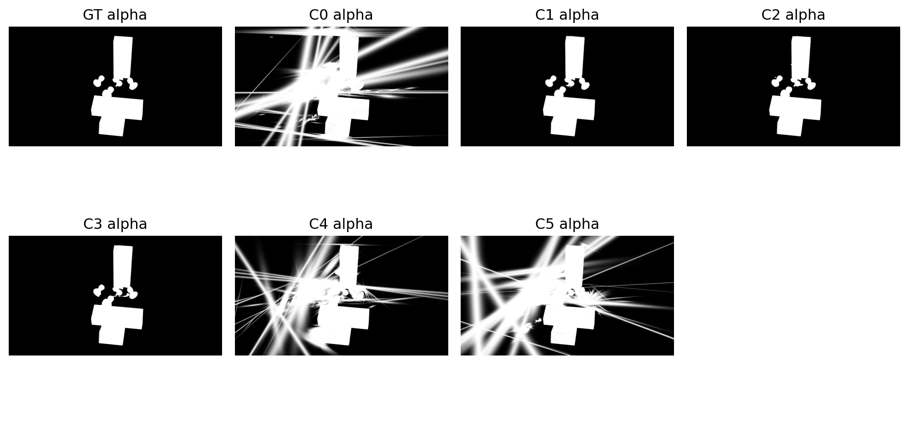
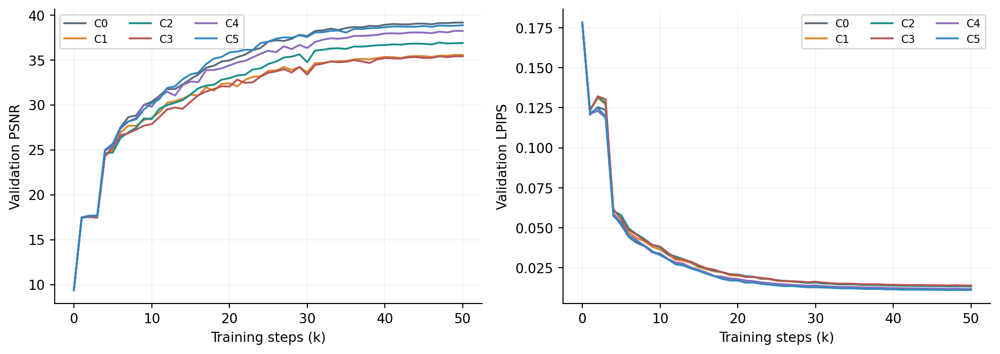
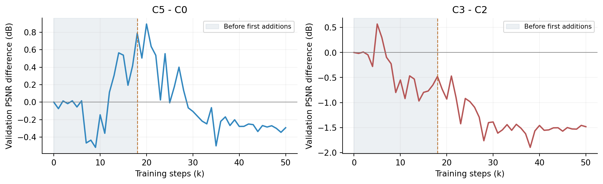
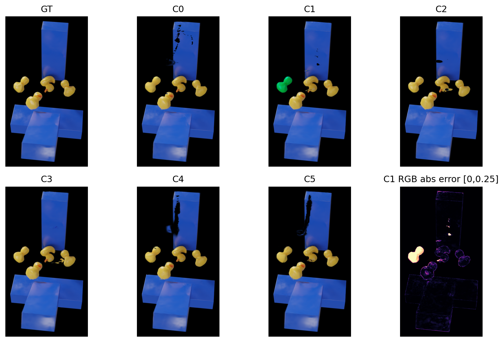
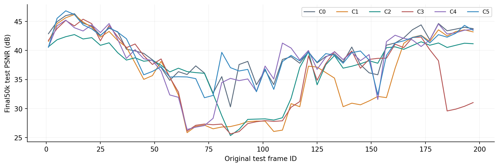
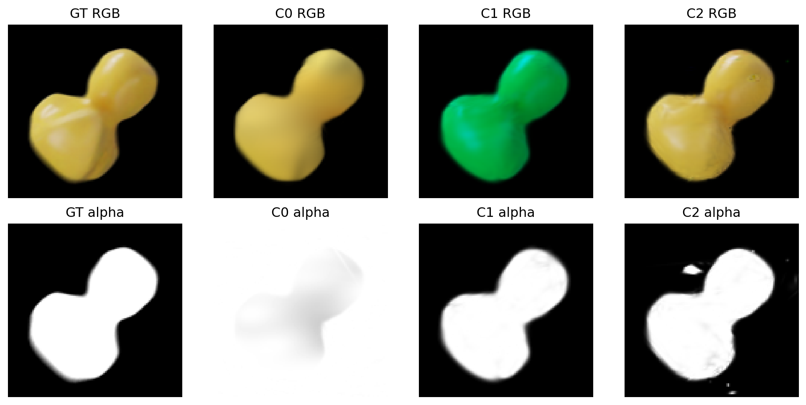

# PIDG Coverage and Neighborhood Ablation Report

## Better coverage, worse RGB reconstruction?

Completed C0-C5 experiments and implementation analysis | 27 October 2026

No added method improves all metrics over V3 in these runs. Mask supervision improves silhouette IoU but reduces RGB quality. Local affine regularization partly recovers the mask-related loss. Density-only stays closest to the reference, with small metric trade-offs and attribution confounds.

### What changes across the six models?

| Model | Mask L1 weight | Local affine weight | Coverage additions |
| --- | --- | --- | --- |
| C0 / V3 | 0 | 0 | Off |
| C1 | 0.1 | 0 | Off |
| C2 | 0.1 | 0.0001 | Off |
| C3 | 0.1 | 0.0001 | On |
| C4 | 0 | 0.0001 | Off |
| C5 | 0 | 0 | On |

### Matched comparison protocol

Scene: Rubber Duck. All arms use W256_D0, the V3 RGB objective and a shared frame-index time axis. Each runs for 50k steps from the same complete random step-0 state; C0 reuses the completed control. Isotropic and velocity-trajectory consistency weights are zero. The 120 train / 30 validation / 50 test images have disjoint timestamps. This is interpolation at interleaved unseen times, not future forecasting.

The main tables use final iteration 50000 for every arm. Four additional best snapshots are selected using validation metrics only. Outputs are 1600 x 900 PNGs. These additions change losses or Gaussian allocation, not MLP width; Gaussian count remains an optimization outcome.

Important scope correction: the scene contains several ducks and obstacles. C2/C3/C4 use unsegmented spatial neighborhoods without real object IDs. Cross-object connectivity has not been ruled out.

## Final RGB metrics: C0 has the highest PSNR

Fixed 50-frame test set; higher PSNR/SSIM/MS-SSIM and lower LPIPS are better

| Model | PSNR | SSIM | LPIPS | MS-SSIM |
| --- | --- | --- | --- | --- |
| C0 | 39.7240 | 0.994333 | 0.010681 | 0.996196 |
| C1 | 35.7459 | 0.992724 | 0.013329 | 0.992781 |
| C2 | 37.1511 | 0.993076 | 0.012812 | 0.994440 |
| C3 | 35.8634 | 0.992693 | 0.013303 | 0.992737 |
| C4 | 38.6373 | 0.993881 | 0.011221 | 0.995312 |
| C5 | 39.3918 | 0.994361 | 0.010570 | 0.996165 |

### Separate isolated and conditional effects

| Contrast | Interpretation | PSNR delta / dB | Better frames / 50 |
| --- | --- | --- | --- |
| C1-C0 | Mask only | -3.9780 | 4 |
| C4-C0 | Affine only | -1.0866 | 17 |
| C5-C0 | Density only | -0.3321 | 17 |
| C2-C1 | Affine after mask | +1.4052 | 27 |
| C3-C2 | Add density to both | -1.2877 | 25 |

C5 slightly improves SSIM and LPIPS over C0, while PSNR and MS-SSIM are slightly worse. This is a trade-off, not a uniform gain. C2 improves over C1 by about 1.41 dB but remains about 2.57 dB below C0. Recovering part of a degradation does not establish superiority to the reference.

C3 beats C2 on 25/50 frames, yet its mean PSNR is 1.29 dB lower. The final eight test timestamps, original IDs 169-197, lose 5.57 dB on average and contribute about 69% of the mean degradation. Failure is concentrated in particular time intervals.

These are observed single-run differences. Trajectories already differ before the new terms activate, so the final deltas are not isolated causal effect estimates.

## Alpha metrics reveal a different trade-off

Silhouette accuracy, interior coverage and RGB reconstruction are distinct objectives

| Model | Foreground PSNR | Mask IoU | Interior low coverage % | Background false coverage % |
| --- | --- | --- | --- | --- |
| C0 | 30.677 | 0.2064 | 0.00185 | 45.60 |
| C1 | 26.442 | 0.9764 | 0.77157 | 0.13 |
| C2 | 28.191 | 0.9842 | 0.03712 | 0.13 |
| C3 | 26.914 | 0.9684 | 0.93528 | 0.19 |
| C4 | 29.521 | 0.2168 | 0.00301 | 52.65 |
| C5 | 30.299 | 0.2360 | 0.00054 | 39.51 |

Full-frame alpha at original frame 153. White indicates high opacity; all panels share the same 0-1 display range.

C0 combines a very low interior hole rate with poor silhouette IoU. It retains substantial high alpha in GT background regions: black RGB is not equivalent to transparency. Mask supervision removes much of this false coverage, but does not establish correct interior color, position or occlusion order.

An opaque black pixel may also look like a hole. Color or occlusion errors of this kind are not counted as low-alpha holes, so foreground RGB must be examined separately.

IoU thresholds both alphas at >0.5. Interior low coverage counts predicted alpha<0.5 inside GT alpha>0.95 eroded by 3 pixels. Background false coverage counts predicted alpha>0.5 where GT alpha<=0.5. Foreground PSNR uses GT alpha>0.5. Results are frame-wise means; exact formulas and denominators are on page 15.

## Audit: differences precede density additions

A shared random initialization does not imply bitwise identical GPU training

Validation every 1k steps. Improvement slows at later steps, with runs settling at different reconstruction levels. Validation curves alone do not establish overfitting.

Shading marks the period before the first additions. Coverage sampling starts at 16k; the first clones are added at 18k, after that step's validation.

| Validation PSNR difference | 15k: before additions | 50k: final |
| --- | --- | --- |
| C5-C0 | +0.5377 | -0.2928 |
| C3-C2 | -0.7969 | -1.4830 |

C3 trails C2 by about 0.80 dB before additions. C5 instead leads C0 by about 0.54 dB at 15k. Final differences therefore cannot all be attributed to cloning. The exact nondeterminism source is unresolved; custom CUDA accumulation and amplification by densification thresholds are candidates.

The affine comparisons have a similar limitation: at 3k, before first activation, C4-C0 and C2-C1 already differ by about -0.08 and +0.07 dB. Shared-state branching and repeated seeds are needed for stronger attribution.

## Matched RGB views and per-frame performance

Original frame 153 / export 00038; the previously discussed difficult frame, with one GT-defined crop

GT and C0-C5 share identical crop coordinates. The final panel shows C1 mean absolute RGB error with a fixed 0-0.25 range. This frame is diagnostic, not a representative sample estimate.

PSNR for all 50 test timestamps, plotted against original frame ID. Connecting segments do not imply test metrics were computed for intervening train/validation frames.

C1 has a clear color error in this frame. C2/C3 retain local shape or occlusion defects. Alpha agreement alone does not ensure correct color. The visible multi-object structure also shows why a distance gate cannot establish object membership.

Dark gaps on the blue obstacles can arise from transparency, wrong color or occlusion. Compare RGB with the alpha panels rather than interpreting every dark patch as missing Gaussian coverage.

## Method 1: foreground coverage supervision

Used by C1/C2/C3; soft silhouette supervision, distinct from random frame removal

### Targets and loss integration

Read the original A channel from the 120 training RGBA images, resize with bicubic interpolation to camera resolution, and divide by 255. The original RGB loader and black-background compositing remain unchanged. This is neither a SAM mask nor a flow-validity mask. Training-membership checks prevent validation/test masks from entering the loss; held-out alpha is used only for evaluation.

L_mask = (1 / HW) sum_p |A(p,t) - M(p,t)|
L_total = L_V3 + 0.1 L_mask + scheduled L_affine
A: rendered accumulated alpha. M: detached GT alpha.
Density additions are a discrete allocation rule, not another differentiable loss.

L_V3 retains pixel L1, SSIM and existing physics/grid regularizers, plus LPIPS with weight 0.02. LPIPS runs every four steps with interval compensation by four. Mask loss runs every step from step 1, without foreground/background balancing, edge weighting, delay or ramp. Isotropic and velocity-trajectory consistency weights are zero.

### Which variables receive gradients?

Visible contributors with active gradients propagate alpha errors into opacity, position, scale and rotation. After deformation warm-up, dynamic centers and covariance also connect to the deformation network. Mask loss has no color target: in the alpha compositing graph, its direct derivative with respect to SH color coefficients is zero. RGB losses still train SH.

Nevertheless, changing geometry, opacity and occlusion changes which SH colors contribute and how RGB gradients are distributed. The mask constrains a 2D silhouette and opacity, not the unique depth, object correspondence, ordering or color.

### Implementation

coverage_tuning/data.py: read_alpha; model.py: mask_loss; runtime.py: coverage_loss; code/train_pidg.py: merge into the total before loss.backward(). Setting mask_weight=0 disables this term.

## Method 2: weak local affine consistency

Used by C2/C3/C4; allows real stretching rather than fixing every neighbor distance

### Neighborhoods and relative coordinates

Select 128 deterministic anchors that cycle with iteration. Find up to eight nearest canonical neighbors per anchor and retain edges shorter than 0.1 world units. X denotes detached canonical coordinates and y(t) the current deformed center. Relative offsets cancel translation.

D_i[j,:] = X_j - X_i; E_i[j,:] = y_j(t) - y_i(t)
B_i = pinv(D_i) E_i; E_fit = D_i B_i
q_i = mean_j ||D_i[j,:]||^2
L_affine = mean_i [mean_j ||E_i[j,:] - E_fit[j,:]||^2 / max(q_i, 1e-8)]

Means use valid edges only. A neighborhood needs at least four edges and a smallest singular value exceeding 1e-4 times its largest. Pseudoinverse rtol is 1e-4. D, its pseudoinverse and the normalization are detached; E and the fitted B remain differentiable with respect to deformation. This regularizer updates the trajectory, not canonical coordinates directly.

### Schedule, permitted motion and limitations

Evaluate every 10 steps after 3k, ramping over 2k steps. The evaluated-step multiplier is 1e-4 x 10 x ramp, compensating for sparse evaluation. Rotation, uniform stretch and shear are allowed. There is no det(F)=1, volume-conservation or constitutive-stress target. B is a fitted local map, not a validated physical deformation gradient F.

Non-affine bending, contact boundaries and relative object motion can also create residuals. Real training supplies no object_ids, so the radius gate cannot guarantee a shared surface or object. The original single_object declaration was not scene-verified and was corrected in interpretation. C4 acknowledges this limitation but still lacks identity isolation.

Implementation: model.py neighborhoods/local_affine_loss and runtime.py trajectory/ramp. Tests cover affine invariance, non-affine gradients and degenerate neighborhoods; they do not prove that real-scene adjacency is correct.

## Method 3: late coverage-guided densification

Used by C3/C5; clone existing contributors supported by deficits at several training times

### Accumulate pixel deficits onto existing Gaussians

d(p,t) = 1[p in eroded GT foreground] x 1[A(p,t) < 0.7]
             x max(0, 0.95 - A(p,t))
S_i = sum of d(p,t) over pixels/times listing i as a contributor
V_i = number of distinct deficit-supporting training frames
Only parents with V_i >= 3 and S_i > 0 are eligible.

Erode GT alpha>0.95 by three pixels. Sample every 20 steps from 16k through 35,999 on a four-pixel grid, reading at most 20 actual footprint contributors per pixel. Each valid listed ID receives the same deficit; the current score is not normalized by RGB/alpha contribution weight. Repeated samples at one timestamp increase score but count as one time vote.

### Cloning, inheritance and budget

At 18k, 20k, ..., 36k, rank eligible parents by S_i and clone at most 512, with a total cap of 200,000 points. Reset scores and votes after each window. Add zero-mean canonical Gaussian jitter with per-axis standard deviation 0.5 x min(parent scale, 0.02). The value 0.02 is not a hard displacement-norm limit.

Children inherit SH, scale, rotation, particle/velocity index and dynamic flag. Clamp initial child opacity to [0.01,0.1]. Keep all parents, with no extra late pruning or opacity reset. Conventional gradient-based densification/pruning still stops at 15k. Additions run after the optimizer step to avoid discarding gradients during parameter replacement.

### What can this strategy recover?

It strengthens weak existing footprints using multi-time evidence. Pixels without any contributor have neither a parent nor reliable depth and are skipped. It cannot seed arbitrary empty geometry, and inherited wrong SH/positions/trajectories may propagate defects. C3/C5 add 879/717 points respectively, a conservative increment rather than global reconstruction.

Implementation: runtime.py observe_coverage/after_update and density.py CoverageAccumulator. Scores and per-point/time votes are stored in a checksum-bound checkpoint sidecar. Selection and cloning run under no_grad.

## Why can mask supervision change color?

Mechanisms implied by this implementation, not a contributor-level causal diagnosis

### 1. Color and alpha share visibility weights

a_i(p) = opacity_i x projected_footprint_i(p)
T_i(p) = product_{j<i} (1 - a_j(p)); w_i(p) = T_i(p) a_i(p)
C(p) = sum_i w_i(p)c_i(view) + T_end(p)b
A(p) = 1 - T_end(p)
Away from sorting/threshold changes: dC/dc_i = w_i; dL_mask/dc_i = 0.

Color c_i comes from per-Gaussian spherical harmonics (SH), not an RGB output of the deformation MLP. The deformation branch predicts center transforms, rotation and scale, with no independent time-conditioned color residual. Although mask loss does not directly update SH, its updates to opacity, position and covariance alter weights w_i, blended colors, occlusion and subsequent SH gradients. Sorting changes are nonsmooth and are not fully described by these derivatives.

### 2. A correct silhouette can have wrong contributors

Many depth, color and Gaussian configurations can yield A near one. A wrongly colored foreground contributor can hide correct points while maintaining high alpha; the mask cannot distinguish this. Occluded points have smaller w_i and weaker RGB correction signals. On black backgrounds, near-zero RGB can result from transparency or opaque, nearly black contributors. Alpha supervision removes some RGB-equivalent solutions and redistributes geometry and color.

### 3. Early supervision and discrete allocation may amplify errors

Mask loss starts at step 1, while d_xyz, d_rotation and d_scaling remain zero for iterations below 3000. Different motion timestamps are sampled against a temporarily static cloud, so silhouette targets may conflict. Mask gradients also enter screen-space positions used by conventional densification before 15k. Consequently, mask supervision can alter point allocation as well as opacity. Both pathways exist in the code; neither has been established as the main cause of this color failure.

## Color failure: evidence and open explanations

Left duck at original frame 153; identical GT-defined region and pixel selection for every model

Top: RGB. Bottom: alpha. Shared crop x=620:735, y=350:465. C1 remains wrongly colored at high opacity, so increasing alpha alone cannot correct this defect.

| Image | Mean R / G / B | Mean alpha | RGB MAE |
| --- | --- | --- | --- |
| GT | 0.733 / 0.625 / 0.269 | 0.9847 | 0.0000 |
| C0 | 0.728 / 0.624 / 0.264 | 0.9454 | 0.0276 |
| C1 | 0.000 / 0.617 / 0.264 | 0.9644 | 0.2630 |
| C2 | 0.729 / 0.620 / 0.263 | 0.9716 | 0.0260 |

Statistics use 3,850 GT pixels satisfying R>100, G>90 and B<130 inside the fixed crop, in 8-bit RGB. This is post hoc localization, not training supervision or a guarantee of shared material-point correspondence. Across all 50 frames, C1 improves silhouette IoU but loses about 4.23 dB of foreground PSNR.

### What does this frame establish?

C1 has zero red at all 3,850 selected pixels, while mean G/B remain close to GT. This makes channel clamping a more specific lead than generic color mixing. However, an 8-bit PNG cannot establish a negative pre-clamp SH value. The mask has not been shown to directly turn yellow into green, and weight 0.1 has not been proven excessive. Other candidates include visibility mismatch, conflicting static warm-up targets and competing gradients.

Proposed checks: mask on/off from one full state; freeze geometry or SH separately; log RGB/mask gradient norms and cosine similarity on shared parameters; compare delayed/ramped and weaker mask weights; inspect contributor color, depth and identity in this region. These checks have not been run.

## A specific lead: clamping of SH color channels

Zero red agrees with a zero-gradient source branch, but contributor-level evidence is still required

### Facts verified in the local implementation

These runs use convert_SHs_python=False. In the CUDA rasterizer, forward.cu computes SH color, adds 0.5, then applies max(result,0) channel-wise and records whether result<0. In backward.cu, dL_dRGB is multiplied by zero for clamped channels before calculating SH and viewing-direction gradients.

q_i,k = SH_i,k(view) + 0.5; c_i,k = max(q_i,k, 0)
If q_i,k < 0, then dc_i,k / dq_i,k = 0.
For that Gaussian, view and channel, the color-evaluation gradient into SH is zero. Increasing RGB/perceptual loss weight alone cannot cross this clamped path.

### Why could this explain a yellow-to-green appearance?

In the fixed region, GT mean R is 0.733, whereas C1 has R=0 at all 3,850 selected pixels, nearly preserved G/B, and alpha about 0.964. If dominant contributors have negative red SH outputs before clamping, the result can stay opaque while losing red light and appearing green. A mask target contains no red-channel information and cannot detect that error from alpha alone.

A testable chain is: mask changes geometry, visibility and gradient allocation; RGB optimization or a changing view direction moves some channels into the clamped region; local zero gradients then impede recovery. We did not log the first negative transition, pre-clamp values, contributor weights or clamp flags here. The chain is therefore a hypothesis, not a confirmed explanation for this run or for every green artifact.

### How to confirm or reject the hypothesis

First perform a read-only diagnostic render of floating-point RGB and record visible contributors, raw SH values, clamp flags and weights. Measure the weighted share of negative-red contributors. Tiny positive values can also quantize to zero in 8-bit PNGs and must be ruled out. Then compare delayed mask supervision and a smooth positive color parameterization under matched initialization/state branching. These are future experiments; neither activation changes nor retraining were performed for this report.

Zero gradient is local to this sample/channel/path, not necessarily permanent: other views or times, geometry changes, contributor replacement and optimizer momentum can still change the outcome.

Source: third_party/PIDG/submodules/flow-based-diff-gaussian-rasterization/cuda_rasterizer/forward.cu, lines 65-70; backward.cu, lines 29-34 and 48-97. Source hashes are preserved in the Chinese report provenance referenced by this companion.

## Interpretation: separate evidence from hypotheses

Synthesis of the method details and color diagnostics; no single cause has been proven

### 1. Mask supervision changes the admissible reconstruction

Evidence: C1 increases silhouette IoU from C0's 0.2064 to 0.9764, but lowers full-image PSNR by about 3.98 dB and foreground PSNR by about 4.23 dB. Degradation is not confined to the background.

Interpretation: black-background RGB can be matched using opaque, nearly black Gaussians. Alpha supervision suppresses that solution and jointly changes scale, opacity, position and deformation gradients. This improves the silhouette objective but may disrupt a favorable RGB allocation. Weight 0.1 applies globally from step 1, while roughly 90% of pixels are background. Gradient balance deserves testing, but no weight sweep establishes that 0.1 is too large.

### 2. Neighborhood regularization can stabilize and restrict

Evidence: C2 improves RGB and interior coverage relative to C1, whereas C4 with affine-only regularization remains below C0. Local cooperation may stabilize incoherent motion under mask supervision, while restricting genuine non-affine detail. Canonical Euclidean neighbors also lack object identities and may couple contacting objects. Actual cross-object edge counts have not been established without labels.

### 3. More points do not guarantee correct geometry

Evidence: C3 adds 879 points and C5 adds 717, ending at 70,258 and 70,848 points; C0 ends at 75,542. Conventional densification has already produced different populations, so an additions arm can still have fewer final points than the reference. The rule clones contributors near weakly covered footprints. It cannot infer depth in contributor-free gaps, and inherited color, scale or trajectories may perpetuate mistakes.

C3's decline relative to C2 cannot be fully attributed to additions because the gap predates them. C5 is close to or slightly above C0 only on selected metrics; this is not evidence of a comprehensive, repeatable reconstruction improvement.

## Next steps: improve attribution before tuning

Recommended experiments only; this report does not launch new training

| Priority | Actionable comparison | Question addressed |
| --- | --- | --- |
| 1 | Branch density on/off from one complete 15k state; retain a 50k total budget and repeat at least three seeds. | Remove pre-addition divergence and test whether a roughly 0.3 dB difference repeats. |
| 2 | Compare weaker and delayed/ramped mask supervision from random initialization; log RGB/mask gradient norms on shared parameters. | Test strength and timing rather than attributing failure to capacity. |
| 3 | Use known object IDs or reliable adjacency filters; propagate IDs through cloning and inspect contact/boundary regions. | Exclude cross-object constraints; color or proximity alone does not establish identity. |
| 4 | Jointly inspect alpha false positives/negatives, foreground RGB and local errors; track new-point contribution and coverage changes. | Avoid apparently good hole rates from opaque background and verify useful additions. |

### What should be retained now?

Keep C0 as the main RGB reference. Retain C5 as a lightweight density candidate, not a default improvement. Mask supervision substantially improves silhouette accuracy and should remain tunable rather than being dismissed. Resolve adjacency reliability before deciding whether local affine regularization belongs in the final model.

### Limits of the conclusions

One scene and one seed provide no repeated-run confidence interval. Gaussian count is an outcome rather than fixed capacity. The split measures interleaved temporal interpolation, not long-gap reconstruction or forecasting. The test set has historical exposure and user-authorized early viewing in this study; it is not a completely untouched final test. No recovery claim is made for GT depth, velocity or force.

Training and validation use disjoint 120/30 images; the fixed 50-frame test set is used for evaluation. All four best snapshots are selected on validation. The main tables use final50k throughout to avoid retrospectively selecting snapshots using test results.

## Absolute paths to renders and comparisons

Each individual gallery contains 250 GT/render pairs: five snapshots x 50 test frames

### C0 / C0_V3_reference

`F:\A_Edinburgh\PhysGauss\runs\pidg_coverage_tuning\render_comparisons\C0_V3_reference\index.html`

`F:\A_Edinburgh\PhysGauss\runs\pidg_coverage_tuning\C0_V3_reference\rubber_duck\test\ours_50000\renders`

### C1 / C1_mask

`F:\A_Edinburgh\PhysGauss\runs\pidg_coverage_tuning\render_comparisons\C1_mask\index.html`

`F:\A_Edinburgh\PhysGauss\runs\pidg_coverage_tuning\C1_mask\rubber_duck\test\ours_50000\renders`

### C2 / C2_mask_affine

`F:\A_Edinburgh\PhysGauss\runs\pidg_coverage_tuning\render_comparisons\C2_mask_affine\index.html`

`F:\A_Edinburgh\PhysGauss\runs\pidg_coverage_tuning\C2_mask_affine\rubber_duck\test\ours_50000\renders`

### C3 / C3_mask_affine_density

`F:\A_Edinburgh\PhysGauss\runs\pidg_coverage_tuning\render_comparisons\C3_mask_affine_density\index.html`

`F:\A_Edinburgh\PhysGauss\runs\pidg_coverage_tuning\C3_mask_affine_density\rubber_duck\test\ours_50000\renders`

### C4 / C4_affine_only

`F:\A_Edinburgh\PhysGauss\runs\pidg_coverage_isolated\render_comparisons\C4_affine_only\index.html`

`F:\A_Edinburgh\PhysGauss\runs\pidg_coverage_isolated\C4_affine_only\rubber_duck\test\ours_50000\renders`

### C5 / C5_density_only

`F:\A_Edinburgh\PhysGauss\runs\pidg_coverage_isolated\render_comparisons\C5_density_only\index.html`

`F:\A_Edinburgh\PhysGauss\runs\pidg_coverage_isolated\C5_density_only\rubber_duck\test\ours_50000\renders`

GT and alpha are in sibling gt and alpha folders. The final50k pairs are in each gallery's pairs/50000 folder. Other tags: best, metric_ssim, metric_lpips and metric_ms_ssim.

### Combined GT + six-model gallery: 50 final50k images

`F:\A_Edinburgh\PhysGauss\runs\pidg_coverage_comparison\final50000\index.html`

Sources: results.json, per_view.json, coverage_metrics_test.json, metric_history.jsonl, metric_best.json, configs, initialization/export receipts, and runtime/model/density implementations. Full hashes and per-frame diagnostics are preserved in the provenance and experiments/coverage_isolated/assessment.json.

## How are the two coverage percentages computed?

Definitions for page 3; both measure 2D alpha coverage and lower is better

A_t(p) is rendered alpha; M_t(p) is GT alpha from the original RGBA frame. Both use the same 1600 x 900 grid and range 0-1. |S| denotes pixel count, not area in 3D.

### 1. Interior low coverage: missing opacity inside the object

I_t = {p: minimum GT alpha in the surrounding 7 x 7 window > 0.95}
h_t = count(p in I_t with A_t(p) < 0.5) / max(|I_t|, 1)
Interior low coverage % = 100 x (1/50) sum_t h_t

I_t is GT alpha>0.95 eroded with a square of radius three pixels, using zero outside the image. This excludes silhouette and semitransparent edges. The denominator is the eroded interior pixel count; the numerator counts alpha<0.5 there. It is not normalized by the full image or all foreground pixels.

### 2. Background false coverage: opacity on true background

B_t = {p: M_t(p) <= 0.5}
f_t = count(p in B_t with A_t(p) > 0.5) / max(|B_t|, 1)
Background false coverage % = 100 x (1/50) sum_t f_t

The denominator is GT background count; the numerator is predicted-foreground count within it. This is FP/(FP+TN), not FP/(TP+FP), and it does not classify background by black RGB. M=0.5 belongs to background. Predicted A=0.5 is counted as neither low coverage nor false coverage.

### Worked pixel counts: original frame 153 / final50k

| Model | Interior: low/total | Frame % | Background: false/total | Frame % |
| --- | --- | --- | --- | --- |
| C0 | 0/127717 | 0.00000 | 408932/1298149 | 31.50 |
| C1 | 0/127717 | 0.00000 | 450/1298149 | 0.03 |

This example is one frame. Main-table values are the equal-weight mean of 50 per-frame fractions, multiplied by 100, not pooled pixel counts. For example, 0.00185% is a fraction of 0.0000185. Empty-region denominators are clamped to one and yield zero.

Evaluation reads 8-bit predicted alpha PNGs; GT alpha is bicubic-resized and scaled to 0-1. These thresholded diagnostics differ from training soft-alpha L1. Opaque color errors are not counted as interior holes. Broad opaque coverage can give low interior holes but high background false coverage. Neither metric establishes 3D watertightness.

Verification: all 300 predicted-alpha images reproduce the stored per-frame interior counts and fractions. Background counts are saved in assessment.json. Implementation: coverage_tuning/model.py interior/coverage_metrics and build_coverage_report.py alpha_diagnostics.
